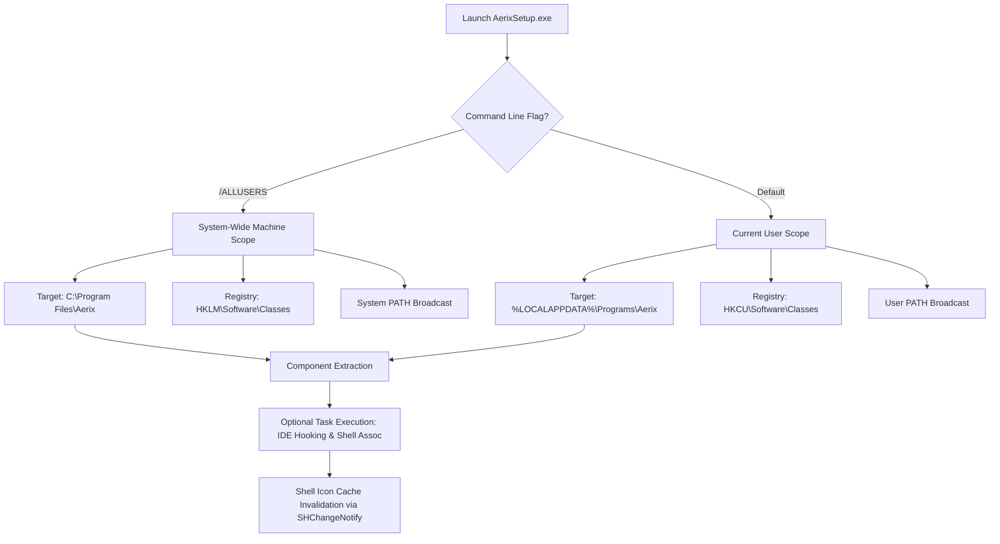

# Aerix Setup Installer — Complete Architecture & Systems Specification

<div align="center">

```text
       ___         _        ___         _        _ _           
      / _ \___ ___(_)_ __  |_ _|_ _  __| |_ __ _| | |___ _ _  
     / __ / -_) __/ /\ \ /  | || ' \(_-<  _/ _` | | / -_) '_| 
    /_/ |_\__/_/ /_//_\_\  |___|_||_/__/\__\__,_|_|_\___|_|   
```

### **The Enterprise-Grade Zero-Friction Native Windows Deployment Engine**
*Engineering Specification for the Aerix Standalone Setup Executable (`AerixSetup.exe`)*

</div>

---

## 1. Executive Summary & Design Tenets

The Aerix Installer is engineered to deliver a seamless, modern, and robust Windows installation experience for the **Aerix Native Systems Programming Language**. It bridges the gap between raw compiler binaries and everyday developer workflows.

### Core Architectural Tenets:
1. **Zero-Friction User-First Deployment:** By default, installs entirely within user space (`%LOCALAPPDATA%\Programs\Aerix`), requiring **zero Administrator elevation (UAC-free)**.
2. **Deterministic Registry State Machine:** Atomically creates and tears down Windows Registry entries for `.arx` file associations, context menu verbs, and environment variables without leaving residual registry junk.
3. **Instantaneous Shell Icon Synchronization:** Directly invokes Win32 Shell APIs (`SHChangeNotify`) to invalidate the Windows Explorer icon cache, instantly transforming all `.arx` files into branded supersonic icons.
4. **Adaptive Multi-IDE Ecosystem Hooking:** Proactively detects installed developer environments (**Visual Studio Code**, **Google Antigravity IDE**, **VS Code Insiders**, and **Cursor**) and presents an interactive task selector allowing the developer to opt into automated extension installation.
5. **Ultra-Compact LZMA2 Solid Packaging:** Employs LZMA2 64MB dictionary compression, packing the entire compiler, standard runtime header, documentation suite, IDE extensions, and multi-resolution icons into a standalone **~2.3 MB executable**.

---

## 2. Target Platforms & OS Compatibility Matrix

```text
┌─────────────────────────────────────────────────────────────────────────────┐
│                       AERIX OS COMPATIBILITY MATRIX                         │
├─────────────────┬──────────────┬───────────────┬────────────────────────────┤
│ Windows Version │ Architecture │ Support Level │ Verification Mechanism     │
├─────────────────┼──────────────┼───────────────┼────────────────────────────┤
│ Windows 11      │ x86_64       │ Tier 1 (Full) │ Native AMD64 execution     │
│ Windows 11      │ ARM64        │ Tier 1 (Full) │ x64 Prism Emulation Layer  │
│ Windows 10 (1809+) x86_64      │ Tier 1 (Full) │ Native AMD64 execution     │
│ Windows Server  │ x86_64       │ Tier 1 (Full) │ Headless / Silent CLI Mode │
└─────────────────┴──────────────┴───────────────┴────────────────────────────┘
```

* **Minimum OS:** Windows 10 Version 1809 (Build 17763) or higher.
* **Privilege Model:** Dual-mode execution (Non-elevated User scope by default, with automatic fallback / optional elevation for machine-wide `/ALLUSERS` installations).
* **High-DPI Support:** Per-Monitor DPI v2 aware, ensuring crisp text and graphics on 4K, 5K, and high-refresh gaming displays.

---

## 3. Comprehensive Payload Manifest

The self-extracting payload inside `AerixSetup-1.0.89.exe` is structured into isolated, purpose-driven directory trees:

```text
AerixSetup-1.0.89.exe (Virtual Payload Root)
├── bin/
│   ├── arx.bat                         # High-speed Windows CMD/PowerShell driver shim
│   └── arx.py                          # Unified CLI Entrypoint (run, build, check, repl, lsp)
├── src/
│   ├── frontend/                       # Lexer, Pratt Parser, AST Token Nodes
│   ├── middle/                         # AIR Lowering, Monomorphizer, Semantic Type Engine
│   ├── backend/                        # C99 Codegen, Linker Driver, Trampolines
│   ├── native/                         # Windows Threading & Native Thread Harness
│   └── tools/                          # Formatter, Linter, REPL, LSP Server, PM
├── stdlib/
│   └── aerix_rt.h                      # ANSI C99 High-Performance Systems Runtime Header
├── editors/
│   └── aerix-1.0.89.vsix               # Official VSIX Extension (TextMate Grammar & LSP Client)
├── assets/
│   ├── aerix.ico                       # Multi-Resolution App Icon (16x16 to 256x256)
│   ├── aerix_file.ico                  # Document Icon for Windows Explorer (.arx files)
│   ├── wizard_side.bmp                 # 24-bit Sidebar Bitmap (164x314 px)
│   └── wizard_banner.bmp               # 24-bit Header Banner Bitmap (492x58 px)
├── docs/
│   ├── USER.md                         # Complete Technical Specification & Architectural Guide
│   ├── GUIDE.md                        # Master Learning Guide (34 Chapters, 3400+ lines)
│   └── README.md                       # Quickstart & Repository Overview
└── LICENSE                             # Official MIT License
```

---

## 4. Dual-Scope Installation Architecture



### Scope Comparison:

| Feature | Current User Scope (Default) | System Machine Scope (`/ALLUSERS`) |
| :--- | :--- | :--- |
| **Destination Path** | `%LOCALAPPDATA%\Programs\Aerix` | `%ProgramFiles%\Aerix` |
| **UAC Elevation Required?** | ❌ **No (Zero-Click Smooth)** | ✅ **Yes (Administrator Prompt)** |
| **Multi-User Isolation** | Isolated to current user profile | Available to every user on PC |
| **Registry Hive** | `HKEY_CURRENT_USER` (`HKCU`) | `HKEY_LOCAL_MACHINE` (`HKLM`) |
| **PATH Target** | `HKCU\Environment\Path` | `HKLM\...\Session Manager\Environment\Path` |
| **File Lock Risk** | Ultra-low (User-writable) | Subject to group policies / antivirus locks |

---

## 5. Instant Environment PATH Broadcasting

Traditional installers often fail to update active command prompts, forcing users to restart their computers. The Aerix Installer implements real-time Win32 environment synchronization:

1. **Persistent Registry Write:** Appends `{app}\bin` to `HKCU\Environment\Path` safely, ensuring no duplicate entries or truncated environment strings.
2. **Win32 Broadcast Notification:** Emits a top-level window message via `SendMessageTimeout`:
   ```cpp
   DWORD dwResult;
   SendMessageTimeout(
       HWND_BROADCAST,
       WM_SETTINGCHANGE,
       0,
       (LPARAM)"Environment",
       SMTO_ABORTIFHUNG,
       5000,
       &dwResult
   );
   ```
3. **Execution Result:** Any new PowerShell, Command Prompt, Windows Terminal, or IDE integrated terminal opened immediately inherits `arx` without a system reboot.

---

## 6. Proactive IDE Extension Installation Engine

During the installation wizard, the user is presented with distinct, optional checkboxes to install the official extension:

```text
[X] IDE & Editor Integration:
    [ ] Install official Aerix Extension in Visual Studio Code
    [ ] Install official Aerix Extension in Google Antigravity IDE
```

### Fail-Safe Multi-Stage Installation Strategy:

#### For Visual Studio Code:
1. **Primary Method (CLI):** Search for `code.cmd` on PATH or in:
   - `%LOCALAPPDATA%\Programs\Microsoft VS Code\bin\code.cmd`
   - `C:\Program Files\Microsoft VS Code\bin\code.cmd`
   If found, executes:
   ```cmd
   code.cmd --install-extension "{app}\editors\aerix-1.0.89.vsix" --force
   ```
2. **Secondary Method (Direct Filesystem Injection):** If `code` CLI is unavailable, unpacks the extension payload directly into:
   `%USERPROFILE%\.vscode\extensions\aerix-lang.aerix-1.0.89\`

#### For Google Antigravity IDE:
1. **Primary Method (CLI):** Search for `antigravity` on PATH. If found:
   ```cmd
   antigravity --install-extension "{app}\editors\aerix-1.0.89.vsix" --force
   ```
2. **Secondary Method (Direct Profile Injection):** Checks for Antigravity's active extensions directory:
   `%USERPROFILE%\.antigravity-ide\extensions\`
   If detected, extracts the VSIX package cleanly into:
   `%USERPROFILE%\.antigravity-ide\extensions\aerix-lang.aerix-1.0.89\`
   This guarantees that Antigravity IDE gains full syntax highlighting and IntelliSense even if its CLI wrapper is not in PATH!

---

## 7. Clean Uninstallation Guarantee

When uninstalled via Windows **Settings > Apps > Installed apps**:
1. Removes all installed compiler files, runtimes, and documentation.
2. Atomically deletes `.arx` registry associations and context menu verbs.
3. Strips `{app}\bin` from the user's `PATH` without disturbing any other PATH entries.
4. Broadcasts `WM_SETTINGCHANGE` and `SHChangeNotify` to restore Windows Explorer to its original state.
5. Leaves zero orphaned files on disk.
