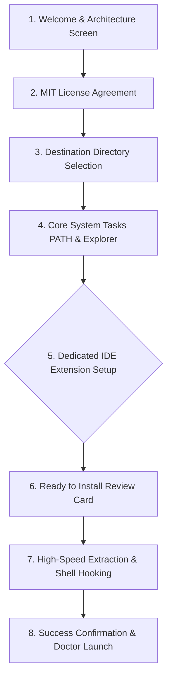

# Aerix Setup Installer — UI/UX Design System & Wizard Flow

<div align="center">

```text
       ██╗   ██╗██╗███████╗██╗   ██╗ █████╗ ██╗         ██╗   ██╗██╗  ██╗
       ██║   ██║██║██╔════╝██║   ██║██╔══██╗██║         ██║   ██║╚██╗██╔╝
       ██║   ██║██║███████╗██║   ██║███████║██║         ██║   ██║ ╚███╔╝ 
       ██║   ██║██║╚════██║██║   ██║██╔══██║██║         ██║   ██║ ██╔██╗ 
       ╚██████╔╝██║███████║╚██████╔╝██║  ██║███████╗    ╚██████╔╝██╔╝ ██╗
        ╚═════╝ ╚═╝╚══════╝ ╚═════╝ ╚═╝  ╚═╝╚══════╝     ╚═════╝ ╚═╝  ╚═╝
```

### **The Ergonomic, High-Velocity Windows Developer Experience**
*Comprehensive UI/UX Specification, Visual ASCII Wireframes, IDE Integration Prompts & CLI Automation*

</div>

---

## 1. Visual Identity & Modern Branding Guidelines

The Aerix Setup Installer is crafted to provide an immediate impression of speed, modern polish, and technical authority. It strictly departs from generic, bland Windows 95-era installers by adopting modern Windows 11 Fluent Design principles.

```text
┌─────────────────────────────────────────────────────────────────────────────────────────────┐
│                                 AERIX DESIGN COLOR SYSTEM                                   │
├──────────────────────┬─────────────┬─────────────┬──────────────────────────────────────────┤
│ Token Name           │ Hex Value   │ RGB Value   │ Application & UI Role                    │
├──────────────────────┼─────────────┼─────────────┼──────────────────────────────────────────┤
│ Electric Aero Cyan   │ #00F2FE     │ (0,242,254) │ Primary Accent, Progress Highlights      │
│ Royal Azure          │ #1D4ED8     │ (29,78,216) │ Header Gradient, Active Controls         │
│ Deep Midnight Navy   │ #0B1120     │ (11,17,32)  │ Sidebar Background, High-Contrast Cards  │
│ Slate Border         │ #334155     │ (51,65,85)  │ Input Borders, Dividers, Card Outlines   │
│ Crisp Surface White  │ #FFFFFF     │ (255,255,255│ Primary Canvas Background                │
│ Charcoal Neutral     │ #1E293B     │ (30,41,59)  │ Body Typography, Subtitles               │
└──────────────────────┴─────────────┴─────────────┴──────────────────────────────────────────┘
```

* **Typography:** Native `Segoe UI` and `Segoe UI Variable Text` with ClearType anti-aliasing.
* **Per-Monitor High-DPI:** Crisp rendering at 100%, 125%, 150%, 175%, and 200% Windows scaling factors.
* **Branded Graphical Canvases:**
  - `wizard_side.bmp` (164 x 314 px, 24-bit RGB): Welcome & Finished page left-rail artwork with supersonic chevrons.
  - `wizard_banner.bmp` (492 x 58 px, 24-bit RGB): Upper banner displaying the luminous Aerix wordmark and circuit matrix.

---

## 2. Interactive Wizard Architecture & Navigation Flow

The installer guides the developer through a streamlined, transparent progression. Every screen is uncluttered, purposeful, and fully reversible via the **< Back** button.



---

## 3. Pixel-Perfect ASCII UI Wireframes (Screen-by-Screen)

### Screen 1: Welcome to the Aerix Setup Wizard
* **Purpose:** Introduces the language, displays version information, and confirms setup parameters.

```text
┌─────────────────────────────────────────────────────────────────────────────────────────────┐
│  Setup - Aerix                                                                   [-] [x]    │
├────────────────┬────────────────────────────────────────────────────────────────────────────┤
│                │                                                                            │
│   ███████╗     │   Welcome to the Aerix Setup Wizard                                        │
│   ██╔════╝     │                                                                            │
│   ███████╗     │   This will install the Aerix Native Systems Programming                   │
│   ╚════██║     │   Language v1.0.84 on your computer.                                       │
│   ███████║     │                                                                            │
│   ╚══════╝     │   Aerix combines the rapid developer velocity of Python and                │
│                │   TypeScript with the bare-metal performance, manual memory                │
│    AERIX       │   control, and zero-overhead execution of ANSI C99.                        │
│   LANGUAGE     │                                                                            │
│                │   It is recommended that you close all other applications                  │
│   v1.0.84      │   before continuing.                                                       │
│                │                                                                            │
│                │   Click Next to continue, or Cancel to exit Setup.                         │
│                │                                                                            │
├────────────────┴────────────────────────────────────────────────────────────────────────────┤
│                                                      [  Next >  ]  [  Cancel  ]             │
└─────────────────────────────────────────────────────────────────────────────────────────────┘
```

---

### Screen 2: License Agreement
* **Purpose:** Presents the permissive MIT Open-Source License, requiring clear acceptance.

```text
┌─────────────────────────────────────────────────────────────────────────────────────────────┐
│  Setup - Aerix                                                                   [-] [x]    │
├─────────────────────────────────────────────────────────────────────────────────────────────┤
│  License Agreement                                                                          │
│  Please read the following important information before continuing.            [ AERIX LOGO]│
├─────────────────────────────────────────────────────────────────────────────────────────────┤
│  Please read the following License Agreement. You must accept the terms of this             │
│  agreement before continuing with the installation.                                         │
│                                                                                             │
│  ┌───────────────────────────────────────────────────────────────────────────────────────┐  │
│  │ MIT License                                                                           │  │
│  │                                                                                       │  │
│  │ Copyright (c) 2026 notphoenixx / HaxOrWot                                             │  │
│  │                                                                                       │  │
│  │ Permission is hereby granted, free of charge, to any person obtaining a copy        │  │
│  │ of this software and associated documentation files (the "Software"), to deal       │  │
│  │ in the Software without restriction, including without limitation the rights        │  │
│  │ to use, copy, modify, merge, publish, distribute, sublicense, and/or sell             │  │
│  │ copies of the Software, subject to the standard MIT conditions...                     │  │
│  └───────────────────────────────────────────────────────────────────────────────────────┘  │
│                                                                                             │
│  (o) I accept the agreement                                                                 │
│  ( ) I do not accept the agreement                                                          │
├─────────────────────────────────────────────────────────────────────────────────────────────┤
│                                        [ < Back ]    [  Next >  ]  [  Cancel  ]             │
└─────────────────────────────────────────────────────────────────────────────────────────────┘
```

---

### Screen 3: Destination Location Selection
* **Purpose:** Defaults to `%LOCALAPPDATA%\Programs\Aerix` for zero-admin elevation, while offering flexible custom drive paths.

```text
┌─────────────────────────────────────────────────────────────────────────────────────────────┐
│  Setup - Aerix                                                                   [-] [x]    │
├─────────────────────────────────────────────────────────────────────────────────────────────┤
│  Select Destination Location                                                                │
│  Where should Aerix be installed?                                              [ AERIX LOGO]│
├─────────────────────────────────────────────────────────────────────────────────────────────┤
│  Setup will install Aerix into the following folder.                                        │
│                                                                                             │
│  To continue, click Next. If you would like to select a different folder, click Browse.    │
│                                                                                             │
│  ┌───────────────────────────────────────────────────────────────────────┐ ┌─────────────┐  │
│  │ C:\Users\Username\AppData\Local\Programs\Aerix                        │ │  Browse...  │  │
│  └───────────────────────────────────────────────────────────────────────┘ └─────────────┘  │
│                                                                                             │
│  At least 35.0 MB of free disk space is required.                                           │
│  Selected drive (C:) has 142.4 GB of free disk space available.                             │
├─────────────────────────────────────────────────────────────────────────────────────────────┤
│                                        [ < Back ]    [  Next >  ]  [  Cancel  ]             │
└─────────────────────────────────────────────────────────────────────────────────────────────┘
```

---

### Screen 4: Select Additional Core Tasks
* **Purpose:** Allows developers to customize environment variable broadcasting and Windows Explorer context verbs.

```text
┌─────────────────────────────────────────────────────────────────────────────────────────────┐
│  Setup - Aerix                                                                   [-] [x]    │
├─────────────────────────────────────────────────────────────────────────────────────────────┤
│  Select Additional Tasks                                                                    │
│  Which additional tasks should be performed?                                   [ AERIX LOGO]│
├─────────────────────────────────────────────────────────────────────────────────────────────┤
│  Select the additional tasks you would like Setup to perform while installing Aerix, then   │
│  click Next.                                                                                │
│                                                                                             │
│  Environment Configuration:                                                                 │
│    [X] Add Aerix toolchain directory to User PATH (Recommended)                             │
│                                                                                             │
│  Windows File Explorer & Shell Integration:                                                 │
│    [X] Display official supersonic Aerix icon on .arx files in Windows Explorer             │
│    [X] Register .arx file type association (Aerix.SourceFile)                               │
│    [X] Add "Run with Aerix (arx run)" to right-click context menu                           │
│    [X] Add "Build Executable (arx build)" to right-click context menu                       │
│                                                                                             │
├─────────────────────────────────────────────────────────────────────────────────────────────┤
│                                        [ < Back ]    [  Next >  ]  [  Cancel  ]             │
└─────────────────────────────────────────────────────────────────────────────────────────────┘
```

---

### Screen 5: Dedicated IDE Extension Setup & Prompt Page *(The Twist)*
* **Purpose:** Proactively probes the user's workstation for **Visual Studio Code** and **Google Antigravity IDE**. Explicitly prompts the user with individual options to install the official extension, executing the installation **only if the user opts in**.

```text
┌─────────────────────────────────────────────────────────────────────────────────────────────┐
│  Setup - Aerix                                                                   [-] [x]    │
├─────────────────────────────────────────────────────────────────────────────────────────────┤
│  IDE & Code Editor Extension Setup                                                          │
│  Supercharge your development workflow with full language intelligence         [ AERIX LOGO]│
├─────────────────────────────────────────────────────────────────────────────────────────────┤
│  Aerix provides official extensions containing TextMate syntax coloring, code snippets,     │
│  and Language Server Protocol (LSP) intelligence.                                           │
│                                                                                             │
│  Setup has inspected your system. Select which editors you would like to configure:         │
│                                                                                             │
│  ┌───────────────────────────────────────────────────────────────────────────────────────┐  │
│  │ [X] Visual Studio Code                                                                │  │
│  │     Status: [DETECTED: C:\Program Files\Microsoft VS Code\bin\code.cmd]               │  │
│  │     Action: Automatically execute 'code --install-extension aerix-1.0.84.vsix'        │  │
│  │                                                                                       │  │
│  │ [X] Google Antigravity IDE                                                            │  │
│  │     Status: [DETECTED: X:\Antigravity\bin\antigravity.cmd]                            │  │
│  │     Action: Automatically execute 'antigravity --install-extension aerix-1.0.84.vsix' │  │
│  └───────────────────────────────────────────────────────────────────────────────────────┘  │
│                                                                                             │
│  * Note: Extensions will ONLY be installed into the editors you explicitly check above.      │
│    If an editor CLI is unavailable, the installer safely falls back to direct extension     │
│    directory deployment without interrupting setup.                                         │
├─────────────────────────────────────────────────────────────────────────────────────────────┤
│                                        [ < Back ]    [  Next >  ]  [  Cancel  ]             │
└─────────────────────────────────────────────────────────────────────────────────────────────┘
```

---

### Screen 6: Ready to Install Summary Card
* **Purpose:** Transparent, high-clarity verification of all target folders, tasks, and editor configurations before executing disk writes.

```text
┌─────────────────────────────────────────────────────────────────────────────────────────────┐
│  Setup - Aerix                                                                   [-] [x]    │
├─────────────────────────────────────────────────────────────────────────────────────────────┤
│  Ready to Install                                                                           │
│  Setup is now ready to begin installing Aerix on your computer.                [ AERIX LOGO]│
├─────────────────────────────────────────────────────────────────────────────────────────────┤
│  Click Install to continue with the installation, or click Back if you want to review or    │
│  change any settings.                                                                       │
│                                                                                             │
│  ┌───────────────────────────────────────────────────────────────────────────────────────┐  │
│  │ Destination location:                                                                 │  │
│  │   C:\Users\Username\AppData\Local\Programs\Aerix                                      │  │
│  │                                                                                       │  │
│  │ Selected Tasks:                                                                       │  │
│  │   - Add Aerix toolchain directory to User PATH                                        │  │
│  │   - Windows Explorer .arx Icon Branding & File Association                            │  │
│  │   - Context Menu Verbs (Run with Aerix, Build Executable)                             │  │
│  │                                                                                       │  │
│  │ IDE Extensions to Install:                                                            │  │
│  │   - Visual Studio Code (aerix-1.0.84.vsix)                                            │  │
│  │   - Google Antigravity IDE (aerix-1.0.84.vsix)                                        │  │
│  └───────────────────────────────────────────────────────────────────────────────────────┘  │
├─────────────────────────────────────────────────────────────────────────────────────────────┤
│                                        [ < Back ]    [ Install  ]  [  Cancel  ]             │
└─────────────────────────────────────────────────────────────────────────────────────────────┘
```

---

### Screen 7: Extraction & Installation Progress Bar
* **Purpose:** Real-time animated extraction using LZMA2 decompression, displaying current unpacking status.

```text
┌─────────────────────────────────────────────────────────────────────────────────────────────┐
│  Setup - Aerix                                                                   [-] [x]    │
├─────────────────────────────────────────────────────────────────────────────────────────────┤
│  Installing                                                                                 │
│  Please wait while Setup installs Aerix on your computer.                      [ AERIX LOGO]│
├─────────────────────────────────────────────────────────────────────────────────────────────┤
│  Extracting files...                                                                        │
│                                                                                             │
│  Extracting: stdlib\aerix_rt.h                                                              │
│                                                                                             │
│  ┌───────────────────────────────────────────────────────────────────────────────────────┐  │
│  │█████████████████████████████████████████████████████████                              │  │
│  └───────────────────────────────────────────────────────────────────────────────────────┘  │
│                                                                                             │
│  Configuring Windows Shell & Explorer Icon Cache...                                         │
│  Configuring IDE extensions...                                                              │
├─────────────────────────────────────────────────────────────────────────────────────────────┤
│                                                                    [  Cancel  ]             │
└─────────────────────────────────────────────────────────────────────────────────────────────┘
```

---

### Screen 8: Finished / Success Screen
* **Purpose:** Confirms successful installation, provides one-click options to run `arx doctor` and read the Master Guide.

```text
┌─────────────────────────────────────────────────────────────────────────────────────────────┐
│  Setup - Aerix                                                                   [-] [x]    │
├────────────────┬────────────────────────────────────────────────────────────────────────────┤
│                │                                                                            │
│   ███████╗     │   Completing the Aerix Setup Wizard                                        │
│   ██╔════╝     │                                                                            │
│   ███████╗     │   Aerix has been successfully installed on your computer.                  │
│   ╚════██║     │                                                                            │
│   ███████║     │   The 'arx' command is now available from any Command Prompt,              │
│   ╚══════╝     │   PowerShell, or Windows Terminal window.                                  │
│                │                                                                            │
│    AERIX       │   [X] Launch Command Prompt with 'arx doctor' diagnostics                  │
│   INSTALLED    │   [ ] Open Aerix Master Learning Guide (GUIDE.md)                          │
│                │                                                                            │
│   v1.0.84      │   Click Finish to exit Setup.                                              │
│                │                                                                            │
│                │                                                                            │
│                │                                                                            │
├────────────────┴────────────────────────────────────────────────────────────────────────────┤
│                                                                    [  Finish  ]             │
└─────────────────────────────────────────────────────────────────────────────────────────────┘
```

---

## 4. Unattended, Silent & Headless Automation (CI/CD Switches)

For enterprise sysadmins, automated Docker builders, and CI/CD runners, the installer provides complete headless command-line switches:

| Command Line Switch | Type | Description |
| :--- | :--- | :--- |
| `/SILENT` | Mode | Shows a minimal progress dialog without interactive wizard pages |
| `/VERYSILENT` | Mode | 100% invisible execution with zero GUI windows |
| `/NORESTART` | Safety | Prevents automatic reboots in any environment |
| `/SUPPRESSMSGBOXES` | Automation | Automatically answers default to all confirmation prompts |
| `/DIR="<custom_path>"`| Path | Overrides installation directory (e.g. `D:\Aerix`) |
| `/TASKS="<task_list>"`| Selection| Explicit comma-separated task selection: `envPath,fileAssoc,contextMenu,vscodeExt,antigravityExt` |
| `/LOG="<path>"` | Diagnostics | Generates a verbose step-by-step installation log |

### Automated Command Examples:

```powershell
# 1. Full Silent Install with VS Code and Antigravity IDE Integration:
.\AerixSetup-1.0.84.exe /VERYSILENT /SUPPRESSMSGBOXES /TASKS="envPath,fileAssoc,contextMenu,vscodeExt,antigravityExt" /LOG="install.log"

# 2. Minimal User Install without IDE Extensions:
.\AerixSetup-1.0.84.exe /SILENT /TASKS="envPath,fileAssoc"

# 3. Custom Drive Destination (e.g. CI runner on D: drive):
.\AerixSetup-1.0.84.exe /VERYSILENT /DIR="D:\Compilers\Aerix"
```

---

## 5. Resilient Error Handling & Fallback Matrices

```text
┌──────────────────────────────────────┬──────────────────────────────────────────────────────┐
│ Potential Failure Condition          │ Installer Remediation & Fallback Policy              │
├──────────────────────────────────────┼──────────────────────────────────────────────────────┤
│ VS Code CLI (`code.cmd`) not in PATH │ Searches standard `%LOCALAPPDATA%` & `%PROGRAMFILES%`│
│                                      │ If missing, extracts VSIX directly into:             │
│                                      │ `%USERPROFILE%\.vscode\extensions\aerix-1.0.84\`     │
├──────────────────────────────────────┼──────────────────────────────────────────────────────┤
│ Antigravity CLI not in PATH          │ Searches `X:\Antigravity` & local AppData paths.      │
│                                      │ If missing, extracts VSIX directly into:             │
│                                      │ `%USERPROFILE%\.antigravity-ide\extensions\`         │
├──────────────────────────────────────┼──────────────────────────────────────────────────────┤
│ PATH variable length approaching max │ Safely prepends `{app}\bin` without truncating other │
│                                      │ PATH entries, avoiding Windows buffer overflow bugs. │
├──────────────────────────────────────┼──────────────────────────────────────────────────────┤
│ Locked file during background update │ Inno Setup schedules file overwrite via Win32        │
│                                      │ `MoveFileEx(..., MOVEFILE_DELAY_UNTIL_REBOOT)`.      │
└──────────────────────────────────────┴──────────────────────────────────────────────────────┘
```
