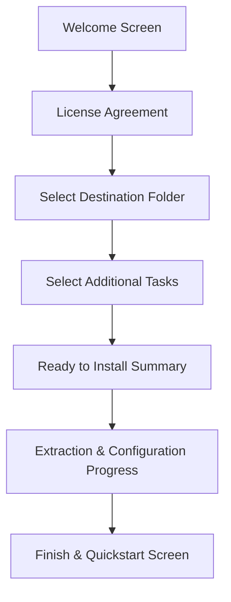

# Aerix Setup Installer — UI/UX Design & Wizard Flow

## 1. Visual Aesthetics & Modern Branding

The installer is styled to match the modern, supersonic aesthetic of the **Aerix Native Systems Language**:

```text
┌─────────────────────────────────────────────────────────────┐
│                       BRANDING PALETTE                      │
├──────────────────────┬─────────────┬────────────────────────┤
│ Color Name           │ Hex Code    │ UI Component           │
├──────────────────────┼─────────────┼────────────────────────┤
│ Electric Aero Cyan   │ #00F2FE     │ Primary Highlights     │
│ Royal Azure          │ #1D4ED8     │ Header Bar / Accents   │
│ Deep Midnight Navy   │ #0B1120     │ Sidebar Background     │
│ Charcoal Neutral     │ #1E293B     │ Text & Dividers        │
│ Crisp Surface White  │ #FFFFFF     │ Main Wizard Window     │
└──────────────────────┴─────────────┴────────────────────────┘
```

* **Typography:** `Segoe UI` (Windows 10 / 11 native font), rendering with sub-pixel ClearType anti-aliasing.
* **Header Graphic (`wizard_banner.bmp`):** 492x58 px strip featuring the Aerix wordmark and subtle circuit gradient.
* **Sidebar Graphic (`wizard_side.bmp`):** 164x314 px vertical banner with the illuminated supersonic dual chevron logo.

---

## 2. Page-by-Page Wizard Navigation Flow



### Page 1: Welcome Screen
* **Title:** *"Welcome to the Aerix Setup Wizard"*
* **Body:** *"This will install the Aerix Native Systems Programming Language v1.0.84 on your computer. Aerix provides the developer velocity of modern scripting combined with the bare-metal speed of native C."*
* **Action:** Next button $\rightarrow$ Proceeds to License.

### Page 2: License Agreement
* Displays the official open-source license (MIT / Dual Apache-2.0).
* Requires selecting *"I accept the agreement"* to proceed.

### Page 3: Destination Location Selection
* **Default Path:** `%LOCALAPPDATA%\Programs\Aerix`
* Displays required disk space (35 MB) and available drive space.
* Includes a **Browse...** button for users who prefer custom drives (e.g. `D:\Tools\Aerix`).

### Page 4: Select Additional Tasks *(Pre-checked by default)*
```text
[X] Environment Configuration
    [x] Add Aerix to User PATH (Recommended)

[X] Windows Shell & Explorer Integration
    [x] Associate .arx files with Aerix
    [x] Display custom Aerix icon on .arx files in Windows Explorer
    [x] Add "Run with Aerix" to right-click context menu
    [x] Add "Build Executable" to right-click context menu

[X] IDE & Editor Tooling
    [x] Install extension for Visual Studio Code
    [x] Install extension for Google Antigravity IDE
```

### Page 5: Ready to Install
* Concise review card summarizing destination folder, selected tasks, and shortcuts.
* Clicking **Install** begins high-speed unpacking.

### Page 6: Progress Bar (High-Speed Extraction)
* Extracts compiler binaries, runtime header (`aerix_rt.h`), and extension package.
* Invokes background registration helpers in under 2 seconds.

### Page 7: Finish Screen
* *"Aerix v1.0.84 has been successfully installed on your computer."*
* Option checkboxes:
  - `[x] Open Aerix Master Guide in browser`
  - `[x] Launch Command Prompt with 'arx doctor'`
* Clicking **Finish** closes the installer cleanly.

---

## 3. Unattended & Headless Installation (CLI Flags)

For developers setting up automated CI/CD pipelines, Docker containers, or provisioning scripts, the installer supports standard silent execution switches:

| Command Line Flag | Effect |
| :--- | :--- |
| `/VERYSILENT` | Runs completely headless with no UI or wizard windows |
| `/SUPPRESSMSGBOXES`| Automatically answers default to all confirmation popups |
| `/NORESTART` | Suppresses any system restart requests |
| `/DIR="C:\Tools\Aerix"` | Overrides destination directory |
| `/TASKS="path,fileassoc"` | Selects specific tasks programmatically |
| `/LOG="setup.log"` | Emits a verbose installation diagnostic log |

#### Example Silent Command:
```cmd
AerixSetup-1.0.84.exe /VERYSILENT /NORESTART /SUPPRESSMSGBOXES
```
