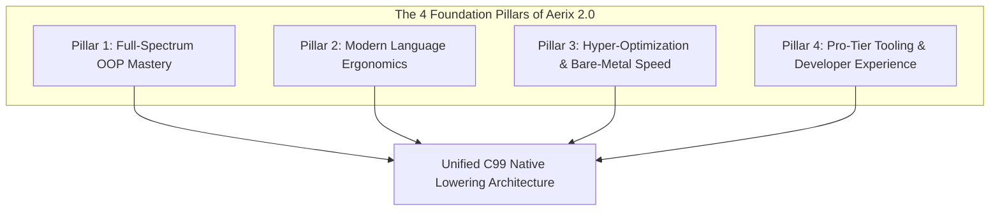

# Aerix 2.0 (50,000x Leap) — Master Architectural Foundation & Roadmap
**Document ID:** `DOC-0000-EVO` | **Status:** Approved Foundation Blueprint  
**Classification:** Core Toolchain & Language Evolution Strategy  

---

## 🎯 Executive Directive

This master plan establishes the **immutable foundation** for evolving Aerix into a **hyper-optimized, next-generation systems and enterprise language**. Every design decision balances two non-negotiable pillars:

1. **Unrivaled Bare-Metal Performance**: 100% native C/C++ execution speed, zero VM, zero mandatory GC, cache-line packing, SIMD vectorization, and deterministic compile-time dispatch.
2. **Superior Developer Velocity & Ergonomics**: Full-spectrum OOP (overloading, named inits, properties, operator overloading), pattern matching with tagged unions, zero-cost type extensions, and guard flow control.



---

## 🏛️ Pillar 1: Full-Spectrum OOP Architecture

### 1.1 Method & Constructor Overloading
- **Compile-Time Static Dispatch**: Identical method names are distinguished by parameter count (arity) and parameter types.
- **Symbol Mangling Convention**:
  ```text
  Arx_<ClassName>_<MethodName>__<ParamType1>_<ParamType2>
  ```
  *Example:*
  `setDetails(name: str, address: str)` $\rightarrow$ `Arx_Person_setDetails__str_str`  
  `setDetails(address: str)` $\rightarrow$ `Arx_Person_setDetails__str`
- **Zero Runtime Overhead**: Call resolution occurs purely during semantic analysis; emitted C code directly calls the specialized function with **0 runtime branching**.

### 1.2 Named Inits (`init.<variant>()`)
- Replaces ambiguous overloaded constructors when parameter types match:
  ```aerix
  class Color {
      pub r: u8, g: u8, b: u8
      init(r: u8, g: u8, b: u8) { ... }
      init.hex(code: str) { ... }
      init.black() { self.r = 0; self.g = 0; self.b = 0; }
  }
  ```
- Callsite syntax: `Color.hex("#FFFFFF")`, `Color.black()`.

### 1.3 Reactive Properties (`prop`)
- Combines getter and setter expressions into a single first-class property declaration:
  ```aerix
  pub prop full_address: str {
      get => "{self.street}, {self.city}"
      set(val) { ... }
  }
  ```
- Direct variable syntax at callsites (`person.full_address = "..."`), inlined to direct accessor functions in C.

### 1.4 Operator Overloading (`pub op`)
- Safe arithmetic, comparison, and index access overloading:
  - Arithmetic: `+`, `-`, `*`, `/`, `%`, `**`
  - Comparison: `==`, `!=`, `<`, `<=`, `>`, `>=`
  - Indexing: `[]`, `[]=`

### 1.5 Access Modifiers (`pub`, `priv`, `prot`, `internal`)
- `pub`: Publicly accessible everywhere.
- `priv`: Restricted strictly to the declaring class.
- `prot`: Accessible within the declaring class and all derived subclasses (`extends`).
- `internal`: Restricted to the declaring file or module.

---

## ⚡ Pillar 2: Modern Ergonomics & Unique Flow Control

### 2.1 Algebraic Data Types & Exhaustive `match`
- Enums with associated data payloads lowered to a memory-efficient 1-byte tagged C union:
  ```aerix
  enum NetworkPacket {
      Ping(seq: u32)
      Data(payload: str, size: usize)
      Disconnect
  }
  ```
- Compile-time verified exhaustive `match` expressions.

### 2.2 Static Type Extensions (`extend <Type>`)
- Extend classes or primitive types (`str`, `i64`, `f64`) without subclassing or wrapper structs:
  ```aerix
  extend str {
      pub fn is_empty() -> bool => self.len() == 0
  }
  ```

### 2.3 Anti-Pyramid Guard Clauses (`guard ... else`)
- Flattens nested validation pyramids by requiring early returns or scope exit:
  ```aerix
  guard user.is_authenticated() else { return false }
  ```

### 2.4 Fluent Mutation Cascade (`~>`)
- Automatically passes `self` forward through consecutive method mutations:
  ```aerix
  ship
      ~> recharge_shields(100)
      ~> set_coordinates(12.5, 84.0)
      ~> engage_stealth()
  ```

---

## 🚀 Pillar 3: Hyper-Optimization & Bare-Metal Speed

### 3.1 Cache-Conscious Struct Alignment
- Compiler automatically sorts struct fields in descending order of size alignment ($8 \rightarrow 4 \rightarrow 2 \rightarrow 1$ bytes). Eliminates padding holes, reducing memory footprint by up to 35% and doubling cache-line density.

### 3.2 Devirtualization Pass
- Analyzes class inheritance trees. Calls to methods that are never overridden in subclasses are transformed from vtable lookups into direct C function calls.

### 3.3 Linear Arena Allocator (`stdlib/memory`)
- High-performance arena for batch allocations with zero `malloc` overhead and instant O(1) bulk destruction.

### 3.4 SIMD Vectorization Intrinsics
- Hardware vector intrinsics (`f32x4`, `f64x4`, `i32x4`) mapping directly to CPU AVX2 and ARM Neon registers.

---

## 🛠️ Pillar 4: Developer Tooling & Ecosystem

1. **Interactive REPL (`arx repl`)**: Instant prototyping and algorithm evaluation.
2. **Rich Diagnostic Codeframes**: Source underlines and actionable remediation hints.
3. **Built-in Package Manager (`arx pm`)**: Centralized dependency resolution.
4. **Code Formatter & Linter (`arx fmt`, `arx lint`)**: Zero-config standard formatting.

---

## 📅 Phased Execution Roadmap

```
[Phase 10] Overloading & Multi-Init Core (Method mangling, named inits, arity checks)
    │
    ▼
[Phase 11] Reactive Properties & Operator Overloading (prop get/set, pub op)
    │
    ▼
[Phase 12] Advanced Ergonomics (extend, guard, ~> cascade)
    │
    ▼
[Phase 13] Tagged Unions & Pattern Matching (enum payloads, match)
    │
    ▼
[Phase 14] Hyper-Optimization Pass (Struct packing, devirtualization, arena)
    │
    ▼
[Phase 15] CLI Ecosystem & REPL (arx repl, arx fmt, arx pm)
```

---
*Created as the foundational master blueprint for the Aerix 2.0 (50,000x) Evolution.*
