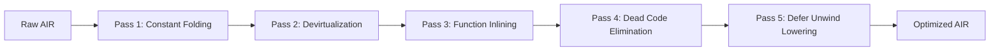
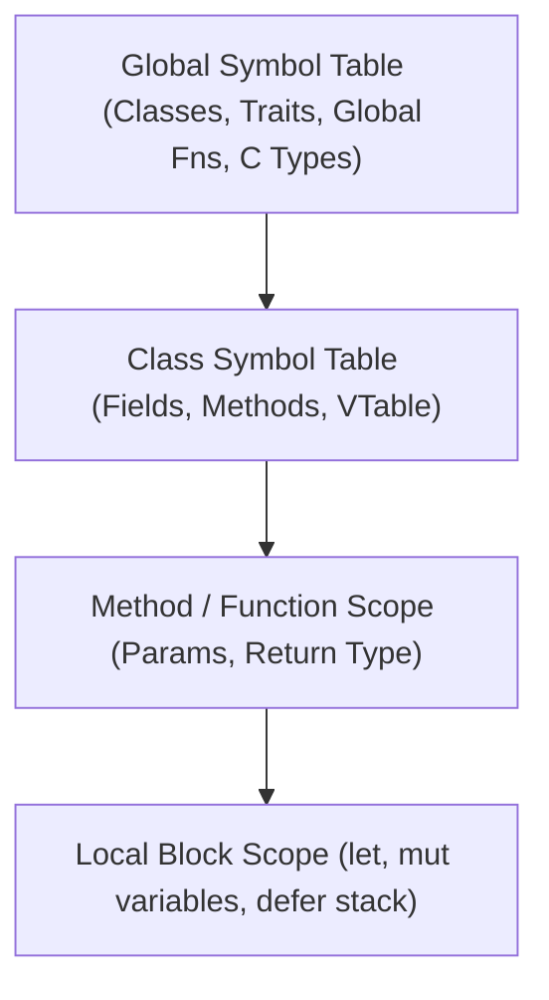

# Aerix Compiler (`arxc`) — Custom Multi-Pass Pipeline & Architecture

> **Compiler Binary:** `arxc` (The Custom Aerix Compiler)  
> **Toolchain Orchestrator:** `arx`  
> **Intermediate Representation:** **AIR** (Aerix Intermediate Representation)  
> **Philosophy:** *A dedicated, custom multi-pass optimizing compiler designed from the ground up for Aerix.*

---

## 1. Architectural Overview

`arxc` is not a naive transliteration tool; it is a **full-fledged custom multi-pass optimizing compiler** featuring its own dedicated **Intermediate Representation (AIR)**, custom optimization passes, and code emission backend:

```
Source (.arx) 
    │
    ▼ [1. Frontend: Lexical Scanner]
Token Stream (with line, col, file coordinates)
    │
    ▼ [2. Frontend: Pratt & Recursive Descent Parser]
Abstract Syntax Tree (AST)
    │
    ▼ [3. Semantic Analysis & Type Engine]
Annotated AST + Symbol Tables + Class Hierarchy Analysis (CHA)
    │
    ▼ [4. IR Lowering: AST ➔ AIR]
Aerix Intermediate Representation (AIR) — 3-Address Code / SSA
    │
    ▼ [5. Custom Optimizer Passes (arxc-opt)]
    ├── Pass 1: Constant Folding & Algebraic Simplification
    ├── Pass 2: Dead Code Elimination (DCE)
    ├── Pass 3: Whole-Program Devirtualization
    ├── Pass 4: Function Inlining
    └── Pass 5: Defer Unwind Stack Lowering
    │
    ▼ [6. Backend Code Generation]
Optimized Machine-Target C99 Source + stdlib/aerix_rt.h
    │
    ▼ [7. Native Machine Linker (GCC / Clang)]
Standalone Native Binary (.exe on Windows / ELF on Linux)
```

---

## 2. Stage 1: Lexical Analysis (`aerix/lexer.py`)

### 2.1 Responsibilities
- Convert raw UTF-8 `.arx` source into a sequential token stream.
- Strip comments (`//` and `/* ... */`) and unnecessary whitespace.
- Track precise source locations: `filename`, `line_number`, and `column_number` for compiler diagnostics.
- Identify string interpolation blocks (`"Value: {x + 1}"`) and tokenize them cleanly.

### 2.2 Token Definition (`aerix/tokens.py`)
Each token is an instance of `Token`:
```python
class TokenType(Enum):
    # Literals
    INT_LITERAL = "INT_LITERAL"
    FLOAT_LITERAL = "FLOAT_LITERAL"
    STRING_LITERAL = "STRING_LITERAL"
    BOOL_LITERAL = "BOOL_LITERAL"
    CHAR_LITERAL = "CHAR_LITERAL"
    IDENTIFIER = "IDENTIFIER"

    # Keywords
    FN = "fn"
    LET = "let"
    MUT = "mut"
    CONST = "const"
    CLASS = "class"
    EXTENDS = "extends"
    TRAIT = "trait"
    IMPLEMENTS = "implements"
    INIT = "init"
    DROP = "drop"
    PUB = "pub"
    PRIV = "priv"
    NEW = "new"
    SELF = "self"
    SUPER = "super"
    IF = "if"
    ELSE = "else"
    MATCH = "match"
    WHILE = "while"
    FOR = "for"
    IN = "in"
    LOOP = "loop"
    BREAK = "break"
    CONTINUE = "continue"
    RETURN = "return"
    DEFER = "defer"
    CINCLUDE = "cinclude"
    CEXTERN = "cextern"

    # Operators
    PLUS = "+"
    MINUS = "-"
    STAR = "*"
    SLASH = "/"
    PERCENT = "%"
    POWER = "**"
    EQUALS = "="
    EQ_EQ = "=="
    NOT_EQ = "!="
    LT = "<"
    LTE = "<="
    GT = ">"
    GTE = ">="
    ARROW = "->"
    FAT_ARROW = "=>"
    PIPE = "|>"
    DOT = "."
    DOT_DOT = ".."
    DOT_DOT_EQ = "..="
    QUESTION = "?"
    QUESTION_QUESTION = "??"
    
    # Delimiters
    LPAREN = "("
    RPAREN = ")"
    LBRACE = "{"
    RBRACE = "}"
    LBRACKET = "["
    RBRACKET = "]"
    COMMA = ","
    COLON = ":"
    SEMICOLON = ";"
    NEWLINE = "NEWLINE"
    EOF = "EOF"
```

---

## 3. Stage 2: Parser & AST (`aerix/parser.py`)

### 3.1 Parser Strategy
- **Recursive Descent** for top-level declarations, statements, class structures, and control flow.
- **Pratt Parsing (Top-Down Operator Precedence)** for expressions, allowing natural handling of:
  - Arithmetic precedence (`*` before `+`)
  - The pipeline operator (`|>`)
  - Member access (`obj.field.method()`)
  - Chained comparisons and logical operators.

### 3.2 Formal Grammar (EBNF Snippet)
```ebnf
Program         ::= TopLevelDecl* EOF ;

TopLevelDecl    ::= FunctionDecl 
                  | ClassDecl 
                  | TraitDecl 
                  | GlobalVarDecl 
                  | CIncludeDecl 
                  | CExternDecl 
                  | Statement ;

FunctionDecl    ::= "fn" IDENTIFIER "(" ParamList? ")" ("->" Type)? Block ;

ClassDecl       ::= "class" IDENTIFIER ("extends" IDENTIFIER)? ("implements" TypeList)? "{" ClassMember* "}" ;

ClassMember     ::= AccessModifier? (FieldDecl | MethodDecl | ConstructorDecl | DestructorDecl) ;

AccessModifier  ::= "pub" | "priv" | "prot" ;

Statement       ::= LetStmt 
                  | MutStmt 
                  | AssignmentStmt 
                  | ReturnStmt 
                  | DeferStmt 
                  | IfStmt 
                  | WhileStmt 
                  | ForStmt 
                  | ExpressionStmt ;

Expression      ::= PipelineExpr ;
PipelineExpr    ::= LogicOrExpr ( "|>" FunctionCall )* ;
```

### 3.3 Core AST Node Hierarchy (`aerix/ast_nodes.py`)
```python
class ASTNode:
    def __init__(self, line: int, col: int):
        self.line = line
        self.col = col

class ProgramNode(ASTNode):
    def __init__(self, declarations: list[ASTNode], line: int, col: int):
        super().__init__(line, col)
        self.declarations = declarations

class FunctionDefNode(ASTNode):
    def __init__(self, name: str, params: list[ParamNode], return_type: str, body: BlockNode, ...):
        ...

class ClassDefNode(ASTNode):
    def __init__(self, name: str, base_class: str | None, traits: list[str], members: list[ASTNode], ...):
        ...

class BinaryOpNode(ASTNode):
    def __init__(self, left: ASTNode, op: str, right: ASTNode, ...):
        ...

class PipelineNode(ASTNode):
    def __init__(self, left: ASTNode, right: CallNode, ...):
        ...

class DeferNode(ASTNode):
    def __init__(self, statement: ASTNode, ...):
        ...
```

---

## 4. Stage 3: Semantic Analysis & Type Checker (`aerix/semantic.py`)

### 4.1 Scope & Symbol Table
The Semantic Analyzer maintains a scoped symbol table:
- **Global Scope:** Global functions, classes, traits, types, C includes.
- **Class Scope:** Fields, methods, access levels (`pub`/`priv`), constructor signatures.
- **Local Scope:** Local variables (`let` vs `mut`), loop variables, parameters.

### 4.2 Core Checks
1. **Immutability Enforcement:** Assigning to a `let` variable triggers a semantic compile error.
2. **Type Inference & Unification:**
   - `let x = 42` infers `i64`.
   - `let f = 3.14` infers `f64`.
   - `let s = "hello"` infers `str`.
3. **OOP Checks:**
   - Inheritance cycle detection.
   - Overridden methods match base signatures.
   - Private member access restriction.
   - Trait interface complete implementation check.
4. **Defer Unwinding Plan:**
   - Registers all `defer` statements in the current block to be synthesized in reverse order before every `return` or scope exit.

---

## 5. Stage 4: Aerix Intermediate Representation (AIR)

Rather than directly translating the syntax tree into target code, `arxc` lowers the AST into **AIR** (Aerix Intermediate Representation) — a typed, linear 3-address code format:

### 5.1 AIR Instruction Set
```python
class AIROp(Enum):
    CONST        = "CONST"        # t0 = 42
    ALLOC        = "ALLOC"        # t1 = alloca(sizeof(T))
    LOAD         = "LOAD"         # t2 = load var_name
    STORE        = "STORE"        # store t2 -> var_name
    BINOP        = "BINOP"        # t3 = t1 + t2
    UNOP         = "UNOP"         # t4 = -t3
    CALL         = "CALL"         # t5 = call fn_name(args...)
    CALL_METHOD  = "CALL_METHOD"  # t6 = call_static Class_method(self, args...)
    CALL_VIRTUAL = "CALL_VIRTUAL" # t7 = call_vtable self->vtable[idx](self, args...)
    GET_FIELD    = "GET_FIELD"    # t8 = getfield obj.offset
    SET_FIELD    = "SET_FIELD"    # setfield obj.offset = val
    BRANCH_IF    = "BRANCH_IF"    # if t0 == false goto label_else
    JUMP         = "JUMP"         # goto label_target
    LABEL        = "LABEL"        # label_target:
    RETURN       = "RETURN"       # ret t0
    DEFER_PUSH   = "DEFER_PUSH"   # push cleanup block to LIFO stack
    DEFER_UNWIND = "DEFER_UNWIND" # synthesize all pending cleanup blocks
```

---

## 6. Stage 5: Custom Optimization Engine (`arxc-opt`)

Aerix runs a sequence of custom AST/AIR optimization passes before code emission:



1. **Pass 1: Constant Folding & Propagation:**
   `let x = 10 * 20 + 5` is evaluated at compile-time directly to `CONST t0 = 205`.
2. **Pass 2: Whole-Program Devirtualization:**
   Inspects the Class Hierarchy (CHA). If a virtual method is never overridden, replaces `CALL_VIRTUAL` with a zero-cost direct `CALL_METHOD`.
3. **Pass 3: Function Inlining:**
   Single-expression arrow functions (`fn double(x: f64) => x * 2.0`) are inlined directly at call sites to eliminate call-frame setup.
4. **Pass 4: Dead Code Elimination (DCE):**
   Removes unreachable basic blocks after unconditional `return` or `break` statements.
5. **Pass 5: Defer Lowering:**
   Unrolls the LIFO defer stack into structured cleanup sequences before all exit paths.

---

## 7. Stage 6: C99 Backend Code Generation (`aerix/codegen.py`)

### 5.1 Codegen Mapping Rules
| Aerix Construct | Generated C99 Representation |
| :--- | :--- |
| `fn add(a: i32, b: i32) -> i32` | `int32_t arx_add(int32_t a, int32_t b) { ... }` |
| `let x = 10` | `const int64_t x = 10;` |
| `mut count = 0` | `int64_t count = 0;` |
| `class Dog` | `typedef struct Arx_Dog { ... } Arx_Dog;` |
| `dog.bark()` | `Arx_Dog_bark(&dog);` (zero-overhead static dispatch) |
| `virtual fn speak()` | Function pointer inside `Arx_Dog_VTable` struct |
| `x \|> f(y)` | `f(x, y)` |
| `defer cleanup(x)` | Emitted before function return points in reverse order |

---

## 6. Stage 5: Native Compilation Driver (`aerix/compiler.py`)

Aerix compiles the emitted C99 source code using MSYS2 / MinGW `gcc.exe` with optimal flags:

```bash
gcc -O3 -std=c99 -march=native -Wall -Wno-unused-variable -flto \
    -I "Z:/VSCode/AerixLang/stdlib" \
    output.c -o program.exe
```

### Compiler Optimization Flags Explained:
- `-O3`: Maximum optimization (vectorization, aggressive inlining, loop unrolling).
- `-std=c99`: Standard, highly portable C target.
- `-march=native`: Emits instructions specifically tuned for the host CPU (AVX2, SSE4, etc.).
- `-flto`: Link-Time Optimization across the whole binary.

---

## 7. Error Diagnostics System

When a lexical, parse, or type error occurs, Aerix prints clean, colored terminal diagnostics with source context and caret pointers:

```text
[AERIX ERROR]: Type Mismatch
  --> src/main.arx:14:18
   |
14 |     let total: i32 = "invalid string"
   |                      ^^^^^^^^^^^^^^^^
   | Expected type 'i32', but found 'str'
```

---

## 8. Pratt Parser Implementation Engine

The Pratt expression parser in `aerix/parser.py` operates via a clean lookup table of prefix and infix parselets:

```python
def parse_expression(self, precedence: Precedence = Precedence.PREC_ASSIGN) -> ASTNode:
    token = self.advance()
    prefix_fn = self.prefix_rules.get(token.type)
    if not prefix_fn:
        self.error(f"Expected expression, found '{token.value}'", token)
    
    left = prefix_fn(token)
    
    while precedence < self.get_current_precedence():
        token = self.advance()
        infix_fn = self.infix_rules.get(token.type)
        if not infix_fn:
            break
        left = infix_fn(left, token)
        
    return left
```

### Infix Parselet for Pipeline Operator (`|>`)
```python
def parse_pipeline(self, left: ASTNode, token: Token) -> ASTNode:
    # Parses: left |> callee(args...)
    # Lowers to a call where 'left' is inserted as the very first argument!
    right = self.parse_expression(Precedence.PREC_CALL)
    if isinstance(right, CallNode):
        right.args.insert(0, left)
        return right
    elif isinstance(right, IdentifierNode):
        return CallNode(callee=right, args=[left], line=token.line, col=token.col)
    else:
        self.error("Right-hand side of '|>' must be a callable function", token)
```

---

## 9. Scoped Symbol Table Architecture (`aerix/semantic.py`)

Symbol resolution uses a lexical environment chain:



Each scope maintains:
1. `symbols: dict[str, Symbol]` (Type, mutability, offset, is_used).
2. `parent: Optional[Scope]` (Pointer to enclosing scope).
3. `defers: list[ASTNode]` (Registered defer statements for this block).

---

## 10. Defer Lowering & Cleanup Synthesis

When emitting C99 code, every `defer <stmt>` is collected on a LIFO stack. When a function or block returns, the compiler synthesizes the cleanup code in reverse order before the return:

```aerix
fn example() -> i32 {
    let res1 = alloc_resource_1()
    defer free_resource_1(res1)

    if something_failed() {
        return -1 // Lowered: free_resource_1(res1); return -1;
    }

    let res2 = alloc_resource_2()
    defer free_resource_2(res2)

    return 0 // Lowered: free_resource_2(res2); free_resource_1(res1); return 0;
}
```
*Generated C99 control-flow pattern (using cleanup block or structured inlining):*
```c
int32_t arx_example(void) {
    int32_t __arx_ret_val = 0;
    void* res1 = alloc_resource_1();
    void* res2 = NULL;

    if (something_failed()) {
        __arx_ret_val = -1;
        goto __defer_cleanup_1;
    }

    res2 = alloc_resource_2();
    __arx_ret_val = 0;

__defer_cleanup_2:
    free_resource_2(res2);
__defer_cleanup_1:
    free_resource_1(res1);
    return __arx_ret_val;
}
```
This guarantees **zero memory leaks**, **zero GC overhead**, and **predictable deterministic cleanup**.

