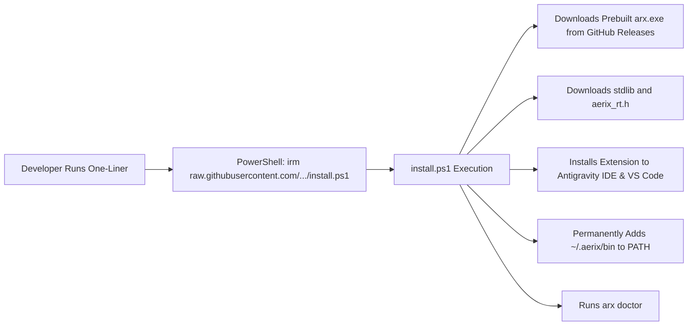

# Aerix (arx) — Global Distribution, Packaging & Installer Specification

> **Target:** Seamless global installation for any developer on Windows, Linux, or macOS.  
> **Goal:** Zero friction — from one-line installation to running `.arx` files anywhere in the world.

---

## 1. Global Installation Experience (Zero Friction)

Aerix provides a true zero-configuration installer. It automatically places binaries in `~/.aerix/bin`, installs runtime headers, permanently configures `PATH`, detects your C compiler (GCC/Clang), and automatically installs syntax highlighting & IntelliSense into both **Antigravity IDE** and **VS Code**.

### 1.1 Windows One-Liner Commands

#### Option A: Local One-Liner (Zero Setup from Cloned / Downloaded Folder)
Run directly from PowerShell inside the repository root:
```powershell
powershell -ExecutionPolicy Bypass -File .\install.ps1
```
*(Or from any directory: `powershell -ExecutionPolicy Bypass -File Z:\VSCode\AerixLang\install.ps1`)*

#### Option B: Global Web One-Liner (For Anyone Worldwide — No Website Needed!)
Anyone on Windows can install Aerix in one command using PowerShell:
```powershell
irm https://raw.githubusercontent.com/<YOUR_GITHUB_USERNAME>/AerixLang/main/install.ps1 | iex
```
*(To create a clean branded link without buying a domain, use a free GitHub Pages URL or a URL shortener like `bit.ly/get-aerix` or `is.gd/aerix`)*.

---

## 2. Distributing Without a Website (GitHub-First Architecture)

You **do not need a paid website or custom domain** to distribute Aerix globally. Modern languages and CLI tools (such as Rustup, Bun, Ripgrep, Neovim, and Zigup) distribute 100% free via **GitHub Releases** and **GitHub Raw CDN**:



### How It Works:
1. **Hosting the Installer Script (`install.ps1`):**
   - GitHub automatically serves raw files from any public repository via their global CDN:  
     `https://raw.githubusercontent.com/<YOUR_USERNAME>/AerixLang/main/install.ps1`
2. **Hosting the Compiled Binaries (`arx.exe`, `arxc.exe`):**
   - Go to your GitHub repository -> **Releases** -> **Draft a new release** (e.g. tag `v1.0.0`).
   - Attach `dist/arx.exe`, `dist/arxc.exe`, and `editors/vscode-aerix/aerix-1.0.0.vsix`.
   - GitHub provides permanent direct download links with unlimited bandwidth at:  
     `https://github.com/<YOUR_USERNAME>/AerixLang/releases/latest/download/arx.exe`
3. **Smart Local Fallback:**
   - If `install.ps1` detects that it is running inside the repository, it installs the local pre-built binaries instantly without making any web requests.

---

## 3. Editor Extensions: Antigravity IDE & VS Code

Aerix provides first-class language support for both modern AI IDEs and standard editors:

### Automated Installation:
Running `install.ps1` automatically searches for installed editors on your machine and installs `aerix-1.0.0.vsix` into:
- [✓] **Antigravity IDE** (`antigravity-ide --install-extension aerix-1.0.0.vsix --force`)
- [✓] **VS Code** (`code --install-extension aerix-1.0.0.vsix --force`)

### Manual Installation Commands:
If you ever want to manually reinstall the extension:
```powershell
# For Antigravity IDE:
& "$env:LOCALAPPDATA\Programs\Antigravity IDE\bin\antigravity-ide.cmd" --install-extension "Z:\VSCode\AerixLang\editors\vscode-aerix\aerix-1.0.0.vsix" --force

# For VS Code:
code --install-extension "Z:\VSCode\AerixLang\editors\vscode-aerix\aerix-1.0.0.vsix" --force
```

### Included Extension Features:
- **High-Fidelity TextMate Grammar**: Full syntax highlighting for all statements, controls, operators, types, and interpolated format strings (`{var}`).
- **4000x IntelliSense Engine**: Auto-completions with documentation for:
  - Primitives: `i8`, `i16`, `i32`, `i64`, `int`, `u8`, `u16`, `u32`, `u64`, `uint`, `f32`, `f64`, `float`, `bool`, `str`, `char`, `void`.
  - Built-in Functions: `print`, `println`, `input`, `readln`, `typeof`, `len`, `panic`.
  - Type-Casting Functions: `to_i32`, `to_i64`, `to_u32`, `to_u64`, `to_f64`, `to_str`, `to_bool`.
- **Custom Brand File Icons**: High-contrast, supersonic neon-cyan `.arx` file badges.

---

## 4. Standalone Native Toolchain (No Dependencies)

Aerix is distributed as frozen standalone executables:
- **`arx.exe`**: Multi-command developer toolchain (`run`, `build`, `new`, `doctor`).
- **`arxc.exe`**: Dedicated direct-to-native AOT compiler.
- Packaged using PyInstaller into self-contained native binaries with embedded standard library assets.
- **End users do NOT need Python installed** — Aerix is fully native.

---

## 5. System Health Engine (`arx doctor`)

Aerix includes built-in diagnostic tools inspired by Flutter:

```bash
arx doctor
```

```text
[AERIX DOCTOR] System Diagnostics
=============================================
  [OK] Aerix Toolchain:    v1.0.0-alpha
  [OK] Host Python:       v3.12.10 (CPython)
  [OK] Platform:          Windows 11 (AMD64)
  [OK] C Backend (GCC):   gcc.EXE (Rev3, Built by MSYS2 project) 13.2.0
      -> Path: Z:\MinGW-64\ucrt64\bin\gcc.EXE
  [OK] Aerix Runtime:     Found at ~/.aerix/stdlib/aerix_rt.h

Status: Aerix is 100% operational and ready to build!
```

---

## 6. Instant Project Bootstrapping (`arx new`)

Initialize a production-ready Aerix project in seconds:
```bash
arx new space_shooter
```
Creates:
```text
space_shooter/
├── aerix.toml
├── src/
│   └── main.arx
└── README.md
```
Run immediately with:
```bash
cd space_shooter
arx run src/main.arx
```
