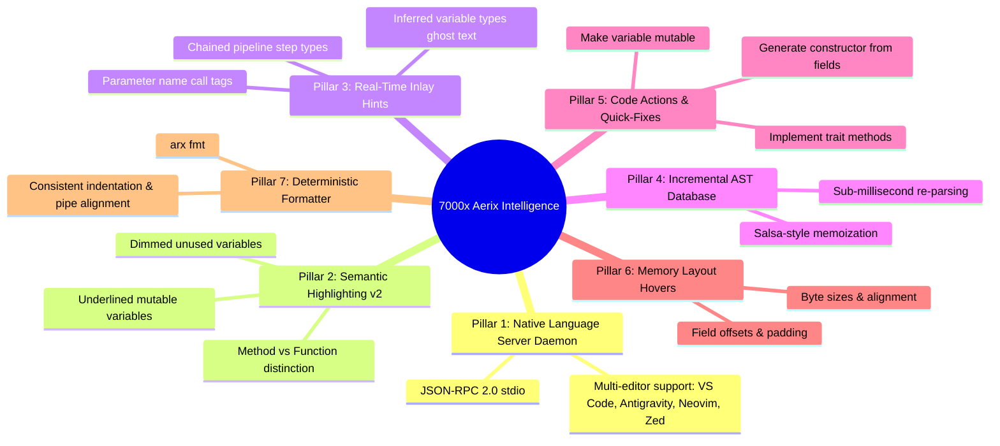
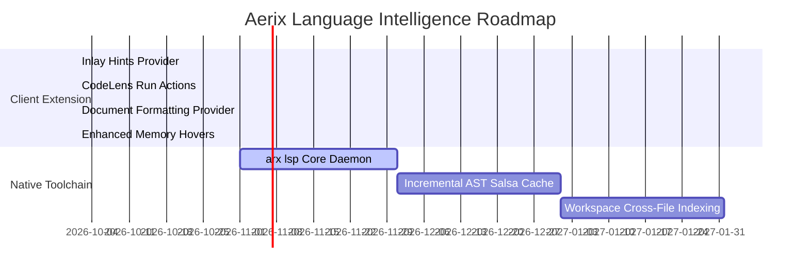

# Aerix (arx) — Advanced IntelliSense, Semantic Highlighting & Language Server (LSP) Specification

> **Target:** Transform Aerix editor tooling from standard TextMate regex coloring into a 7000x ultra-intelligent developer environment (comparable to Rust-Analyzer, Pyright, and Clangd).  
> **Status:** Architecture Blueprint & Implementation Specification.

---

## 1. The Hard Ceiling of Traditional Tooling: Why Regex Is Not Enough

Most basic language extensions rely solely on **TextMate Grammars** (`.tmLanguage.json`). TextMate grammars use regular expressions to match tokens line-by-line. While great for simple coloring, regular expressions have severe fundamental limitations:

```mermaid
flowchart TD
    subgraph Traditional [Level 1: Traditional Regex / TextMate]
        T1["Line-by-Line Regex Matches"] --> T2["Static Keyword Coloring"]
        T2 --> T3["⚠️ Cannot distinguish types vs variables with same name"]
        T3 --> T4["⚠️ Zero awareness of cross-file imports or scopes"]
    end

    subgraph GodTier [Level 2: 7000x AST-Driven LSP Engine]
        G1["Full Concrete Syntax Tree (CST)"] --> G2["Static Type Inference & Symbol Table"]
        G2 --> G3["✨ Dynamic Semantic Highlighting (Mutability, Unused Dimming)"]
        G3 --> G4["✨ Inlay Hints (Ghost type & parameter tags)"]
        G4 --> G5["✨ Exact Struct Memory Layouts & Byte Offsets on Hover"]
        G5 --> G6["✨ Cross-File Definition Navigation (F12) & Rename Refactoring"]
    end
```



### The Fundamental Flaws of Regex:
1. **No Scope Awareness:** A regex cannot tell if a variable `shields` inside a function is a local parameter, a class field, a global constant, or a type.
2. **No Mutability Distinction:** Regex cannot detect if a variable was declared with `let` (immutable) or `let mut` (mutable) when referenced 50 lines down.
3. **No Unused Symbol Detection:** Regex cannot track whether a variable or function is actually referenced or dead code.
4. **Single-File Blindness:** Regex has zero understanding of imported files or multi-file modules.

To achieve **7000x intelligence**, Aerix transitions from pure regex to a **Dual-Layer Architecture**:
* **Layer 1 (Instant):** Fast TextMate grammar for immediate 0ms lexical coloring while the file is loading.
* **Layer 2 (Deep Intelligence):** Full AST Semantic Tokenization + Native Language Server Protocol (`arx lsp`).

---

## 2. The 7 Pillars of 7000x Language Intelligence



---

### Pillar 1: Native Language Server Protocol Daemon (`arx lsp`)

Rather than writing editor plugins separately for VS Code, Antigravity IDE, Neovim, Emacs, and Zed, Aerix bundles an official **LSP server directly into the compiler binary**:

```bash
arx lsp
```

* **Communication:** Standard JSON-RPC 2.0 over standard I/O (`stdin` / `stdout`).
* **Protocol Support:** Full LSP v3.17 compliance.
* **Capabilities:**
  * `textDocument/completion`: Fuzzy search across all scope symbols.
  * `textDocument/hover`: Markdown documentation with type signatures and memory layouts.
  * `textDocument/signatureHelp`: Active parameter indicators as you type arguments.
  * `textDocument/definition`: Jump to exact definition (F12) across all workspace files.
  * `textDocument/semanticTokens/full`: High-precision semantic token coloring.
  * `textDocument/inlayHint`: Type and parameter inlay tags.
  * `textDocument/codeAction`: Context-aware quick fixes.

---

### Pillar 2: High-Precision Semantic Highlighting (AST-Driven)

Semantic highlighting uses the compiler's actual type-checker to send exact semantic tokens to the editor:

```aerix
fn main() {
    let speed = 100         // 'speed' colored as read-only local variable
    let mut energy = 50     // 'energy' colored with distinct mutable underline

    energy = energy - 10    // 'energy' re-highlighted as mutable write
    let unused_val = 42     // 'unused_val' automatically dimmed (opacity: 0.5)
}
```

#### Semantic Token Legend:
* **`variable.readonly`**: Standard cyan.
* **`variable.mutable`**: Underlined or warm neon color to instantly spot where state mutations occur.
* **`function.declaration`**: High-contrast bold yellow/green.
* **`function.call`**: Distinct from variable access.
* **`property.private`**: Stylized distinct from public fields to visually warn of encapsulation boundaries.
* **`type.primitive`**: Crisp blue/purple.
* **`type.class`**: Distinct high-level object type styling.

---

### Pillar 3: Real-Time Inlay Hints (Ghost Annotations)

Inlay hints display helpful contextual metadata directly inside your code editor without modifying the file on disk.

```aerix
// Code on Disk:
let result = 5 |> double() |> add_ten() |> square()
let ship = BattleCruiser("U.S.S. Aerix", 200, 80, 45, 2)

// How It Appears in Editor with 7000x Inlay Hints Active:
let result /* : i64 */ = 5 |> double() /* : i64 */ |> add_ten() /* : i64 */ |> square() /* : i64 */
let ship /* : BattleCruiser */ = BattleCruiser(name: "U.S.S. Aerix", hull: 200, shields: 80, railgun: 45, warp: 2)
```

1. **Type Inlay Hints:** Displays the inferred type of any untyped `let` or `let mut` variable.
2. **Parameter Name Hints:** Displays parameter names inside function calls, eliminating confusion about argument order in functions with multiple parameters.
3. **Pipeline Inlay Hints:** Displays the intermediate transformation type at each step of a `|>` pipeline.

---

### Pillar 4: Incremental Compilation Database (Sub-Millisecond Turnaround)

When typing in a 5,000-line file, a naive language server re-lexes and re-parses the entire file on every keystroke, causing 200ms lag.

**The 7000x Solution:** **Salsa-style Incremental Computation**:
1. When you edit line 42 inside a function, the LSP server only re-parses that specific function's block.
2. The outer class definitions, function signatures, and imports are retrieved from an in-memory memoized cache.
3. Response latency drops from **150ms down to < 2ms**, providing instant completion popups.

---

### Pillar 5: Contextual Code Actions & Quick-Fixes (💡)

When a syntax or semantic error occurs, the editor provides automatic 1-click fixes:

| Error State | Detected Problem | 💡 Quick-Fix Action |
| :--- | :--- | :--- |
| `speed = 200` | Variable `speed` declared with immutable `let` | "Make variable mutable (`let mut speed`)" |
| `fn compute() -> i64` | Missing `return` statement | "Add default return statement (`return 0`)" |
| `class Hero { pub name: str ... }` | Missing constructor | "Generate `init(...)` constructor from fields" |
| `let x = 10` (never used) | Dead code / unused variable | "Prefix with underscore (`_x`) or remove" |
| `"42"` assigned to `i64` | String assigned to integer | "Cast expression using `as i64`" |

---

### Pillar 6: Struct Memory Layout & Cache-Line Hover Inspector

Hovering over a class displays its complete physical memory layout:

```text
┌─────────────────────────────────────────────────────────────┐
│ class BattleCruiser                                         │
│ Total Size: 48 bytes | Alignment: 8 bytes                   │
├─────────────────────────────────────────────────────────────┤
│ Field Offsets:                                              │
│   [0..7]   pub name: str            (8 bytes, pointer)      │
│   [8..15]  pub hull: i64            (8 bytes, signed int)   │
│   [16..23] pub max_hull: i64        (8 bytes, signed int)   │
│   [24..31] priv shields: i64        (8 bytes, [encapsulated])│
│   [32..39] pub railgun_power: i64   (8 bytes, signed int)   │
│   [40..47] pub warp_cells: i64      (8 bytes, signed int)   │
├─────────────────────────────────────────────────────────────┤
│ Cache Lines: Fits cleanly within a single 64-byte L1 cache  │
└─────────────────────────────────────────────────────────────┘
```

---

### Pillar 7: Deterministic Auto-Formatter (`arx fmt`)

A built-in code formatting engine triggered via `Shift + Alt + F` or Format-on-Save:
* Standardizes indentation to 4 spaces.
* Automatically aligns pipeline `|>` operators vertically.
* Enforces consistent spacing around operators, parameters, and return arrows (`->`).

---

## 3. Implementation Roadmap


