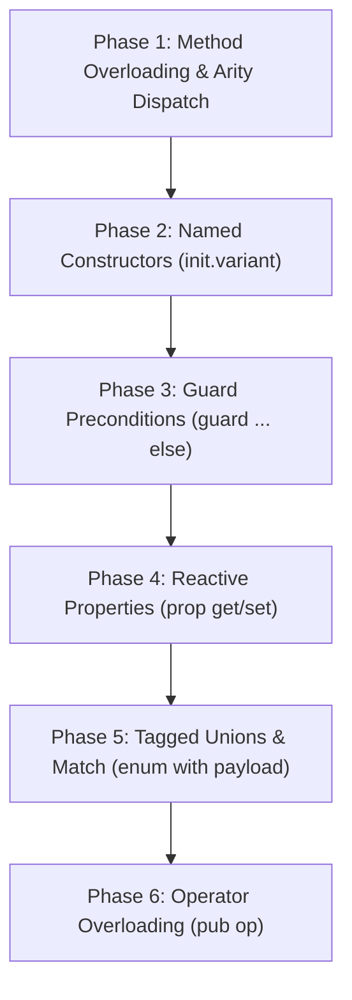

# Aerix Language Specification: Advanced OOP & Unique Language Features
**Document ID:** `DOC-0011` | **Status:** Draft Proposal & Architecture Spec | **Target Version:** `Aerix v1.1.0+`  
**Classification:** Core Language Design & Syntax Innovation  

---

## Executive Summary

Aerix blends **zero-cost systems performance** (ANSI C99/C11 compilation, deterministic memory management, zero-overhead vtables) with **modern, ergonomic object-oriented programming (OOP)** and **functional composition**. 

This specification introduces features inspired by the best aspects of **C++, Rust, Swift, Kotlin, Dart, and Python**, while re-imagining them with **unique Aerix syntax, zero runtime penalty, and native C lowering strategies**.

> [!IMPORTANT]
> **Implementation Guardrail:** This document outlines the syntax, semantic rules, and compiler lowering pipelines for upcoming features. As requested, **no compiler code will be modified until explicit approval and instruction is provided.**

---

## Feature Comparison Matrix

| Feature Concept | Inspiration Sources | Aerix Innovation | C Lowering Strategy |
| :--- | :--- | :--- | :--- |
| **Method Overloading** | C++, Java, C# | **Type-Mangling + Arity Specialization**: Strict type-safe compile-time dispatch without implicit lossy widening. | Distinct C function names: `Arx_Class_method__<type_mangling>` |
| **Named Inits & Multi-Constructors** | Swift, Dart, Python `@classmethod` | **`init.<name>()` Constructor Variants**: First-class named constructors with separate arities and clear callsite semantics. | `Arx_Class_init_<variant>(&instance, ...)` |
| **Reactive Properties (`prop`)** | C#, Swift, Kotlin | **Unified Field-Accessor Syntax**: Looks like a variable field, executes inline get/set expressions with zero call overhead. | Inlined directly into field access or inline wrapper functions. |
| **Operator Overloading** | C++, Python, Rust | **Safe `pub op` Grammar**: Restricts overloadable symbols to deterministic arithmetic, comparison, and index access. | Inline helper `arx_op_<name>_<op>(a, b)` |
| **Type Extensions** | Kotlin, C#, Swift Protocols | **`extend <Type>` Blocks**: Add methods to existing classes or primitive types (`str`, `i64`) without modifying their definition. | Static C functions receiving the target as first argument. |
| **Tagged Unions & Pattern Matching** | Rust, Swift, OCaml | **`enum` with Data Payloads + `match` Expressions**: Memory-efficient C union with a 1-byte discriminator tag. | C tagged `struct { uint8_t tag; union { ... } data; }` |
| **Guard Flow Control** | Swift | **`guard <cond> else { <exit> }`**: Inverted condition guard that flattens nested `if/else` ladders. | C `if (!(cond)) { <exit> }` |
| **Cascade Mutation Operator** | Dart (`..`) | **`~>` Fluent Mutation Pipeline**: Chains multiple method calls on the same instance while always returning `self`. | Inlined sequence of calls with invariant object pointer. |
| **Abstract & Sealed Classes** | Kotlin, Java, Scala | **Compile-time Interface Contracts**: Zero vtable cost when statically knowable, optional dynamic vtable when polymorphic. | Static vtables `Arx_<Class>_vtable` struct pointers. |

---

## 1. Method & Constructor Overloading

### The Problem in Current Aerix
Currently, if two methods share the same name (e.g. `setDetails(name: str, address: str)` and `setDetails(address: str)`), the compiler registers only one in the symbol table, causing a collision in the generated C backend.

### The Aerix Solution: Static Type Mangling
Aerix permits multiple methods and constructors with the same base identifier, provided their **parameter counts (arities) or parameter types differ**.

```aerix
class Person {
    pub name: str
    pub address: str

    // Default primary constructor
    init(name: str) {
        self.name = name
        self.address = "Unassigned"
    }

    // Overloaded constructor with full data
    init(name: str, address: str) {
        self.name = name
        self.address = address
    }

    // Overload 1: Update both fields
    pub fn set_details(name: str, address: str) -> void {
        self.name = name
        self.address = address
    }

    // Overload 2: Update only address
    pub fn set_details(address: str) -> void {
        self.address = address
    }
}
```

#### Callsite Usage
```aerix
fn main() {
    mut p1 = Person("NOTPHOENIX")                     // Dispatches to init(name: str)
    mut p2 = Person("Robin", "Quadrant 9 Sector A")   // Dispatches to init(name: str, address: str)

    p1.set_details("Earth Citadel Room 12")           // Dispatches to set_details(str)
    p1.set_details("PHOENIX-PRIME", "Sector VII")     // Dispatches to set_details(str, str)
}
```

#### Compiler Lowering to C
The compiler calculates an unambiguous type signature hash for each overload:
```c
// C Code Generation:
void Arx_Person_init__str(Arx_Person* self, const char* name);
void Arx_Person_init__str_str(Arx_Person* self, const char* name, const char* address);

void Arx_Person_set_details__str(Arx_Person* self, const char* address);
void Arx_Person_set_details__str_str(Arx_Person* self, const char* name, const char* address);
```

---

## 2. Named Constructors (`init.<name>()`)

While standard overloading distinguishes by type, complex systems often require constructors with identical parameter types but different initialisation semantics (e.g. creating a `Color` from RGB vs from Hex).

Aerix introduces **Named Inits**:

```aerix
class Vector3D {
    pub x: f64, y: f64, z: f64

    // Primary init
    init(x: f64, y: f64, z: f64) {
        self.x = x
        self.y = y
        self.z = z
    }

    // Named Variant 1: Origin (0, 0, 0)
    init.zero() {
        self.x = 0.0
        self.y = 0.0
        self.z = 0.0
    }

    // Named Variant 2: Uniform scale (s, s, s)
    init.uniform(scale: f64) {
        self.x = scale
        self.y = scale
        self.z = scale
    }
}
```

#### Callsite Usage
```aerix
fn main() {
    let v1 = Vector3D(1.0, 2.5, 3.0)       // Primary
    let v2 = Vector3D.zero()               // Named zero init
    let v3 = Vector3D.uniform(10.0)        // Named uniform init
}
```

---

## 3. Reactive Properties with `prop`

In traditional languages, developers write boilerplate getters and setters (`get_name()` / `set_name()`). In Aerix, the `prop` keyword defines a property that behaves like a variable to callers, but triggers custom logic under the hood.

```aerix
class SpaceStation {
    pub name: str
    priv raw_dock_count: i64

    init(name: str) {
        self.name = name
        self.raw_dock_count = 0
    }

    // Computed Property (Read-Only)
    pub prop status_summary: str {
        get => "Station {self.name} has {self.raw_dock_count} active docks"
    }

    // Encapsulated Property with Validation
    pub prop docks: i64 {
        get => self.raw_dock_count
        set(val) {
            if val < 0 {
                println("[ERROR]: Docks cannot be negative!")
                return
            }
            self.raw_dock_count = val
        }
    }
}
```

#### Callsite Usage
```aerix
fn main() {
    mut station = SpaceStation("Citadel-One")
    station.docks = 12                     // Invokes set(val)
    println(station.docks)                // Invokes get => 12
    println(station.status_summary)       // Read-only computed prop
}
```

---

## 4. Operator Overloading (`pub op`)

Aerix allows classes to participate naturally in mathematical and indexing expressions through `pub op`:

```aerix
class ComplexNumber {
    pub real: f64, imag: f64

    init(real: f64, imag: f64) {
        self.real = real
        self.imag = imag
    }

    // Addition operator (+)
    pub op +(other: ComplexNumber) -> ComplexNumber {
        return ComplexNumber(self.real + other.real, self.imag + other.imag)
    }

    // Equality operator (==)
    pub op ==(other: ComplexNumber) -> bool {
        return self.real == other.real && self.imag == other.imag
    }

    // String representation operator
    pub fn to_str() -> str {
        return "{self.real} + {self.imag}i"
    }
}
```

#### Callsite Usage
```aerix
fn main() {
    let c1 = ComplexNumber(3.0, 4.0)
    let c2 = ComplexNumber(1.0, 2.0)
    let c3 = c1 + c2                      // Inlined to Arx_ComplexNumber_op_add(&c1, &c2)

    if c1 == c2 {                         // Inlined to Arx_ComplexNumber_op_eq(&c1, &c2)
        println("Identical")
    }
}
```

---

## 5. Type Extensions (`extend <Type>`)

Instead of forcing developers to wrap primitive types or inherit from base classes, Aerix supports **zero-cost static extensions**:

```aerix
// Extend the built-in string type:
extend str {
    pub fn is_empty() -> bool {
        return self.len() == 0
    }

    pub fn quote() -> str {
        return "\"{self}\""
    }
}

// Extend integer primitive:
extend i64 {
    pub fn clamp(min_val: i64, max_val: i64) -> i64 {
        if self < min_val { return min_val }
        if self > max_val { return max_val }
        return self
    }
}
```

#### Callsite Usage
```aerix
fn main() {
    let message = "   "
    if message.trim().is_empty() {
        println("Blank message")
    }

    let shield_level = 150
    let valid_shield = shield_level.clamp(0, 100)  // 100
    println("Shield clamped to: {valid_shield}")
}
```

---

## 6. Tagged Unions & Pattern Matching (`enum` + `match`)

Unlike simple C enums (which are just integers), Aerix enums can carry **data payloads** (similar to Rust `enum` or Swift `enum with associated values`), combined with an exhaustive `match` expression:

```aerix
enum MissionStatus {
    Standby
    InTransit(destination: str, eta_hours: f64)
    EngagingEnemy(threat_level: i32)
    Aborted(reason: str)
}

fn print_mission_report(status: MissionStatus) -> void {
    match status {
        Standby => {
            println("[STATUS]: Ship awaiting departure orders.")
        },
        InTransit(dest, eta) => {
            println("[STATUS]: En route to {dest}. ETA: {eta} hours.")
        },
        EngagingEnemy(level) => {
            println("[RED ALERT]: Engaging Class {level} enemy vessel!")
        },
        Aborted(reason) => {
            println("[ABORT]: Mission halted: {reason}")
        }
    }
}
```

#### Compiler Representation in C99
```c
typedef enum {
    MissionStatus_Standby,
    MissionStatus_InTransit,
    MissionStatus_EngagingEnemy,
    MissionStatus_Aborted
} MissionStatus_Tag;

typedef struct {
    MissionStatus_Tag tag;
    union {
        struct { const char* destination; double eta_hours; } InTransit;
        struct { int32_t threat_level; } EngagingEnemy;
        struct { const char* reason; } Aborted;
    } data;
} MissionStatus;
```

---

## 7. Guard Flow Control (`guard ... else`)

Deeply nested `if-else` blocks (often called "pyramids of doom") make systems code hard to audit. The `guard` statement enforces preconditions early and mandates exiting scope if false:

```aerix
fn execute_orbital_strike(ship: BattleCruiser, target: str) -> bool {
    // Early exit precondition 1:
    guard ship.is_operational() else {
        println("[ABORT]: Ship offline!")
        return false
    }

    // Early exit precondition 2:
    guard ship.get_railgun_power() >= 50 else {
        println("[ABORT]: Insufficient railgun charge!")
        return false
    }

    // Happy path continues un-nested!
    ship.fire_primary_railgun(target)
    return true
}
```

---

## 8. Fluent Cascade Mutation (`~>`)

Aerix already has the functional forward pipeline operator (`|>`). For object-oriented workflows where multiple configuration steps mutate the same object, Aerix introduces the **cascade operator (`~>`)**:

```aerix
fn main() {
    mut cruiser = BattleCruiser("Titan-IV", 500, 200, 85, 4)

    // Fluently mutate the cruiser: each ~> executes a method on the instance
    // and automatically threads the instance forward
    cruiser
        ~> recharge_shields(100)
        ~> set_details("Orion Sector Patrol")
        ~> show_readiness_report()
}
```

---

## 9. Implementation Roadmap & Phases



### Next Steps When Ready to Code:
1. **Parser Extension**:
   - Allow multiple methods with matching names in `ClassDefNode`.
   - Add AST nodes for `NamedInitNode`, `PropNode`, `GuardNode`, and `OpOverloadNode`.
2. **Semantic Analysis**:
   - Implement type-mangled method lookup table in `ClassType`.
   - Validate arity and parameter signatures during call resolution.
3. **AIR & Codegen**:
   - Emit mangled C function symbols (`Arx_Class_method__<types>`).
   - Generate C call expressions targeting the exact mangled variant.

---
*Created for Aerix Language Evolution. All specifications strictly conform to ANSI C99 backend targets.*
