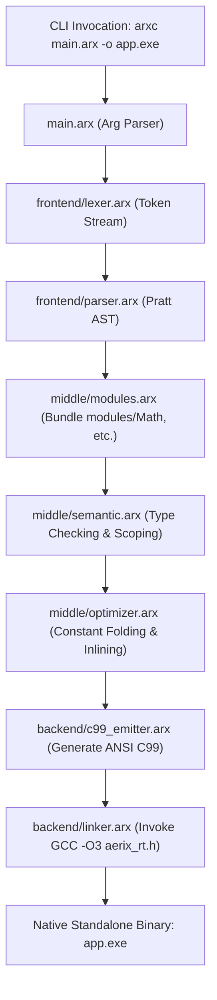

# Aerix (arx) — Self-Hosting Native Compiler & Bootstrap Architecture Specification

> **Document Version:** 1.0.0-PROPOSAL  
> **Status:** 📋 ARCHITECTURAL BLUEPRINT (ON HOLD — PENDING USER "START" COMMAND)  
> **Target Toolchain:** Aerix Self-Hosting Native Engine (`arxc` written in 100% Pure `.arx`)  
> **Axiom:** Zero Breaking Changes — 100% Backward Compatibility with Existing Aerix Code & Test Vectors.

---

## 🎯 1. Executive Summary & Design Vision

### 1.1 What is Self-Hosting?
A programming language achieves **self-hosting (bootstrapping)** when its compiler is implemented in the language itself. From this milestone forward:
1. The language is no longer a guest running inside a host environment (like Python).
2. The compiler compiles its own source code down to native machine binaries.
3. Every optimization added to the compiler makes future compilations faster (virtuous cycle).

### 1.2 The Unified Native Engine Vision: Unifying `arxc` and `arx`
Currently:
- `arx` (Python + C dispatcher) orchestrates the developer toolchain (`run`, `build`, `module`, `doctor`, `pm`, etc.).
- `arxc` is the standalone compiler entrypoint.

**The Target Architecture:**
The self-hosted native compiler, written in Aerix, will be called **`arxc`**, and it will **absorb the entire capability set of `arx` natively**:
```
┌────────────────────────────────────────────────────────────────────────┐
│                   UNIFIED NATIVE ENGINE (arxc)                         │
├────────────────────────────────────────────────────────────────────────┤
│ • Direct Compilation:    arxc main.arx -o app.exe --release           │
│ • Zero-Delay Run:        arxc run main.arx (or arxc main.arx)         │
│ • Fast Type-Checking:    arxc check main.arx                           │
│ • C99 Inspection:        arxc emit-c main.arx -o app.c                 │
│ • Inbuilt Modules:       arxc module list / arxc module verify <name>  │
│ • Package Management:    arxc pm init / arxc pm add / arxc pm list     │
│ • System Diagnostics:    arxc doctor                                   │
│ • Project Scaffolding:   arxc new <project_name>                       │
│ • Editor LSP Server:     arxc lsp                                      │
│ • WebAssembly Target:    arxc wasm main.arx --serve                    │
└────────────────────────────────────────────────────────────────────────┘
```
The command `arx` will become an instantaneous alias/symlink to `arxc`, preserving 100% command-line ergonomics while delivering sub-millisecond execution speeds.

---

## 🛡️ 2. Non-Breaking Guarantee (Backward Compatibility Invariants)

Self-hosting will **NOT** alter, break, or depreciate any existing language construct. All existing syntax, runtime guarantees, and test suites must pass without regression:

| Language Invariant | Stability Guarantee |
| :--- | :--- |
| **Pratt Operator Precedence** | 14-level Pratt hierarchy (`|>`, `~>`, arithmetic, logical, assignments) remains identical. |
| **Dual-Paradigm Syntax** | Procedural top-level functions (`fn`), expressions (`=>`), and full OOP (`class`, `extend`, `pub op`) preserved. |
| **Module System (Phase 25)** | Inbuilt directory bundling (`import Math`), case-sensitive validation, and `.module_verified` remain standard. |
| **Multi-File Imports** | Relative file imports (`import "./helper.arx"`, selective `import { a, b } from "..."`) remain fully supported. |
| **Zero-Cost C99 Emission** | Generates ANSI C99 using [stdlib/aerix_rt.h](file:///z:/VSCode/AerixLang/stdlib/aerix_rt.h) with zero virtual dispatch when types are statically resolved. |
| **All Existing Examples** | All 40 examples (`01_hello_world.arx` through `40_MODULE_SYSTEM.arx`) must compile with zero errors. |
| **Test Suite Baseline** | All 183 automated unit tests in `src/tests/` must maintain 100% pass rates. |

---

## 🔍 3. Language Gap Analysis: Prerequisites for Self-Hosting

A compiler is a complex text processor, graph transformer, and systems program. To write a production compiler in pure `.arx`, the following 4 core capabilities must be available in the language:

```
                          ┌──────────────────────────┐
                          │   Aerix Self-Hosting     │
                          │   Prerequisite Pillars   │
                          └─────────────┬────────────┘
                                        │
         ┌──────────────────┬───────────┴──────────┬──────────────────┐
         ▼                  ▼                      ▼                  ▼
┌─────────────────┐ ┌───────────────┐    ┌─────────────────┐ ┌────────────────┐
│   PILLAR 1:     │ │  PILLAR 2:    │    │   PILLAR 3:     │ │  PILLAR 4:     │
│ Dynamic Text &  │ │ Associative   │    │ System & OS     │ │ AST Nodes &    │
│ Memory Arrays   │ │ Hash Maps     │    │ Process Interop │ │ Diagnostics    │
│ (List<T>, String│ │ (Map<K, V>)   │    │ (fs, os, args)  │ │ (OOP / Errors) │
└─────────────────┘ └───────────────┘    └─────────────────┘ └────────────────┘
```

---

### Pillar 1: Dynamic Collections & Owned Strings (Phase 21 — ✅ ALREADY IMPLEMENTED)
Compilers operate on dynamic buffers: token streams, statement lists, and string identifiers.
Aerix already provides monomorphized `List<T>`, dynamic `String`, and slice views verified in `src/tests/test_phase21_collections.py`.

#### A. Monomorphized Growable Array: `List<T>`
A generic heap-allocated dynamic array with $O(1)$ amortized append:
```aerix
class List<T> {
    pub fn new() -> List<T>
    pub fn push(mut self, item: T)
    pub fn pop(mut self) -> T
    pub fn len(self) -> i64
    pub fn capacity(self) -> i64
    pub fn clear(mut self)
    pub fn get(self, index: i64) -> T
    pub fn set(mut self, index: i64, item: T)
    pub fn op[](self, index: i64) -> T
    pub fn op[]=(mut self, index: i64, item: T)
}
```

#### B. Dynamic Owned String: `String`
A mutable, heap-allocated UTF-8 string with slicing and formatting:
```aerix
class String {
    pub fn new() -> String
    pub fn from(raw: string) -> String
    pub fn push_char(mut self, ch: i8)
    pub fn append(mut self, text: string)
    pub fn append_str(mut self, text: String)
    pub fn len(self) -> i64
    pub fn as_cstr(self) -> string
    pub fn char_at(self, index: i64) -> i8
    pub fn substring(self, start: i64, end: i64) -> String
    pub fn split(self, delimiter: string) -> List<String>
    pub fn starts_with(self, prefix: string) -> bool
    pub fn ends_with(self, suffix: string) -> bool
    pub fn trim(self) -> String
    pub fn contains(self, needle: string) -> bool
}
```

---

### Pillar 2: Associative Hash Maps & Symbol Tables (Phase 22 — ✅ ALREADY IMPLEMENTED)
A compiler requires fast symbol lookup (variable scope stacks, keyword tables, type definitions).
Aerix already provides Robin Hood `Map<K, V>`, `Set<T>`, and tuples verified in `src/tests/test_phase22_data_structures.py`.

#### `Map<K, V>` (Robin Hood Hash Table)
```aerix
class Map<K, V> {
    pub fn new() -> Map<K, V>
    pub fn insert(mut self, key: K, val: V)
    pub fn get(self, key: K) -> V
    pub fn contains(self, key: K) -> bool
    pub fn remove(mut self, key: K) -> bool
    pub fn len(self) -> i64
    pub fn keys(self) -> List<K>
    pub fn values(self) -> List<V>
    pub fn op[](self, key: K) -> V
    pub fn op[]=(mut self, key: K, val: V)
}
```

**Compiler Usage in Aerix:**
- `keywords: Map<string, TokenType>` for $O(1)$ keyword recognition.
- `scopes: List<Map<string, TypeInfo>>` for lexical variable scoping.
- `types: Map<string, ClassDescriptor>` for OOP type checking.

---

### Pillar 3: System, File I/O & Process Interop (🚀 PRIMARY MISSING CAPABILITY)
The compiler must read `.arx` files from disk, write `.c` intermediate files, execute GCC, and inspect directories.
Currently, Aerix has no standard `File` or `Process` primitives in `aerix_rt.h`. Adding these C runtime wrappers is the primary prerequisite before writing the compiler.

#### Standard Library Inbuilt Module: `std/fs` and `std/os`
Implemented via zero-cost C runtime wrappers in [stdlib/aerix_rt.h](file:///z:/VSCode/AerixLang/stdlib/aerix_rt.h):

```aerix
// File System Primitives
class File {
    pub static fn read_to_string(path: string) -> String
    pub static fn write_string(path: string, content: string) -> bool
    pub static fn append_string(path: string, content: string) -> bool
    pub static fn exists(path: string) -> bool
    pub static fn remove(path: string) -> bool
    pub static fn copy(src: string, dst: string) -> bool
}

class Directory {
    pub static fn exists(path: string) -> bool
    pub static fn create(path: string) -> bool
    pub static fn list_files(path: string) -> List<String>
    pub static fn list_files_with_ext(path: string, ext: string) -> List<String>
}

// Operating System & Process Primitives
class Process {
    pub static fn execute(cmdline: string) -> i32
    pub static fn run_capture(cmdline: string) -> String
}

class Env {
    pub static fn args() -> List<String>
    pub static fn get(var_name: string) -> String
    pub static fn set(var_name: string, val: string)
    pub static fn exit(code: i32)
}
```

---

### Pillar 4: AST Hierarchy & Diagnostic Reporting
Using Aerix's native OOP inheritance ([Phase 3 & 11](file:///z:/VSCode/AerixLang/docs/03_OOP_AND_TYPE_SYSTEM.md)), AST nodes are modeled as polymorphic classes with clean constructors:

```aerix
class Node {
    pub let line: i64;
    pub let col: i64;
    pub init(line: i64, col: i64) {
        self.line = line;
        self.col = col;
    }
}

class StmtNode : Node { ... }
class ExprNode : Node { ... }

class BinaryExpr : ExprNode {
    pub let op: string;
    pub let left: ExprNode;
    pub let right: ExprNode;
    pub init(left: ExprNode, op: string, right: ExprNode, line: i64, col: i64) : super(line, col) {
        self.left = left;
        self.op = op;
        self.right = right;
    }
}
```

---

## 🏛️ 4. Native Compiler Architecture (`src\bootstrap`)

The pure Aerix compiler will be structured as modular `.arx` packages inside `src\bootstrap`:

```
z:\VSCode\AerixLang\src\bootstrap\
├── main.arx               # CLI entrypoint, argument parser & toolchain router
├── config.arx             # Compiler flags (-o, --release, --emit-c, etc.)
│
├── frontend\
│   ├── tokens.arx         # Token types & Token class
│   ├── lexer.arx          # Source scanner with line/col tracking
│   ├── ast.arx            # AST class hierarchy
│   └── parser.arx         # 14-level Pratt precedence expression climbing parser
│
├── middle\
│   ├── types.arx          # Type representations (primitives, classes, arrays)
│   ├── scope.arx          # Lexical scope & symbol table
│   ├── semantic.arx       # Semantic type analyzer & immutability verifier
│   ├── modules.arx        # Phase 25 module resolver & case-sensitive bundler
│   └── optimizer.arx      # Constant folding, devirtualization & dead code removal
│
├── backend\
│   ├── c99_emitter.arx    # High-performance C99 code generator
│   └── linker.arx         # GCC orchestration & native machine binary linking
│
└── tooling\
    ├── runner.arx         # Fast-path compile-and-run caching engine
    ├── doctor.arx         # Environment diagnostics (GCC, paths, OS)
    ├── package_mgr.arx    # aerix.toml dependency manager
    └── scaffolding.arx    # 'new' project generator
```

### 4.1 Execution Flow of Native `arxc`


---

## 🚀 5. The 3-Stage Bootstrapping Pipeline

Bootstrapping proceeds in three deterministic, verifiable stages to guarantee correctness:

### Stage 0: Initial Cross-Compilation via Python
The existing Python compiler compiles the new pure-Aerix source code:
```powershell
python src/arx.py build src/native_arxc/main.arx -o dist/arxc_stage1.exe --release
```
**Outcome:** `dist/arxc_stage1.exe` is a native binary capable of compiling Aerix code.

### Stage 1: Self-Compilation
`arxc_stage1.exe` is used to compile its own source code:
```powershell
dist\arxc_stage1.exe build src/native_arxc/main.arx -o dist/arxc_stage2.exe --release
```
**Outcome:** `dist/arxc_stage2.exe` was produced by an Aerix-compiled binary.

### Stage 2: Fixed-Point Convergence & Graduation
`arxc_stage2.exe` compiles `src/native_arxc/main.arx` one more time to produce `arxc_stage3.exe`:
```powershell
dist\arxc_stage2.exe build src/native_arxc/main.arx -o dist/arxc_stage3.exe --release
```
**Verification Criterion (Fixed-Point):**
`arxc_stage2.exe` and `arxc_stage3.exe` must produce identical emitted C source code byte-for-byte:
```powershell
fc /b dist\stage2_out.c dist\stage3_out.c
```
When this matches, the compiler has reached **fixed-point stability**! `arxc_stage3.exe` becomes the official native toolchain.

---

## 📅 6. Step-by-Step Implementation Roadmap

```
[Prerequisite Phase A] Standard I/O & Collections Foundation
  │  ├── Milestone A.1: Dynamic List<T> (Allocation, Push, Indexing)
  │  ├── Milestone A.2: Owned String (Append, Substring, Split)
  │  ├── Milestone A.3: Robin Hood Map<K, V> (Lookup, Insertion)
  │  └── Milestone A.4: Inbuilt File, Directory, Process & Env classes
  │
[Native Compiler Phase B] Core Compiler Pipeline in Pure Aerix
  │  ├── Milestone B.1: Native Lexer (tokens.arx & lexer.arx)
  │  ├── Milestone B.2: Native Pratt Parser (ast.arx & parser.arx)
  │  ├── Milestone B.3: Native Module Resolver (Phase 25 logic in modules.arx)
  │  ├── Milestone B.4: Native Semantic Analyzer (types.arx & semantic.arx)
  │  └── Milestone B.5: Native C99 Emitter & Linker (c99_emitter.arx & linker.arx)
  │
[Toolchain Unification Phase C] Developer Experience in Pure Aerix
  │  ├── Milestone C.1: Fast run caching (runner.arx)
  │  ├── Milestone C.2: Module CLI (module list & module verify)
  │  ├── Milestone C.3: System doctor & project new scaffolding
  │  └── Milestone C.4: PM package dependency management
  │
[Graduation Phase D] 3-Stage Bootstrap & Production Release
     ├── Milestone D.1: Stage 1 Build via Python Compiler
     ├── Milestone D.2: Stage 2 Self-Hosting Loop
     ├── Milestone D.3: Stage 3 Fixed-Point Byte Verification
     └── Milestone D.4: Replace bin/arx.exe with standalone native binary
```

---

## 🔒 7. Risk Mitigation & Quality Invariants

1. **Dual-Compiler Validation:** During development of `src/native_arxc/`, every test vector will be compiled by BOTH the Python compiler and the native compiler. Their test outputs will be compared for 100% equivalence.
2. **Zero In-Place Rewrites:** The existing Python compiler in `src/arx.py`, `src/frontend/`, etc., will remain untouched as the trusted golden reference until Stage 2 bootstrap passes all 183 unit tests.
3. **No External Dependencies:** The native compiler will link only with standard C runtime (`libc`, `kernel32.lib` on Windows) and `aerix_rt.h`. No external third-party libraries required.
4. **Performance Target:** The self-hosted `arxc` compiler will compile `.arx` sources at $> 50{,}000$ lines of code per second, achieving instant sub-10ms developer turnarounds.

---

> **Plan Status:** Complete Architectural Blueprint Saved.  
> **Awaiting:** User explicit **`Start`** command to initiate implementation phases.
